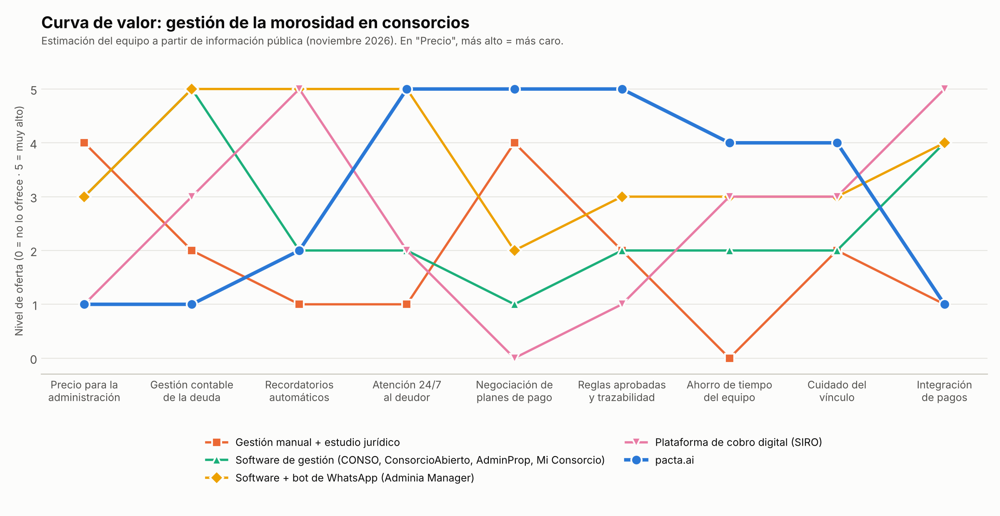

# Benchmarking y Curva de Valor

Estudio de las alternativas que hoy usan las administraciones de consorcios para gestionar la morosidad, y comparación con pacta.ai mediante una curva de valor (Clase 06 — Estrategia del Océano Azul).

> **Alcance:** relevamiento hecho por el equipo en noviembre de 2026 a partir de información pública: sitios web, notas de prensa y directorios de software. Las puntuaciones de la curva de valor son una estimación del equipo, no una medición. Los precios pueden cambiar.

---

## 1. Contexto del mercado

- **Morosidad:** según el último relevamiento de ConsorcioAbierto (unos 15.000 consorcios usuarios de su plataforma), el 15% de las unidades funcionales de CABA y el 16% de las de Provincia de Buenos Aires tiene deuda de expensas (Infobae, agosto 2026). En marzo de 2026, el mismo relevamiento informaba 19% para CABA y Provincia en conjunto. En los barrios que monitorea, la deuda equivale en promedio al 23% de lo liquidado (junio 2025).
- **Interés por mora:** ronda el 4,8% mensual en CABA y el 6,1% en Provincia de Buenos Aires (iProfesional, marzo 2026).
- **Cómo se cobra hoy:** diálogo, intimación por escrito, propuesta de plan de pagos y, como último recurso, juicio ejecutivo. El certificado de deuda debe aprobarlo el Consejo de Propietarios, si existe.

---

## 2. Competidores relevados

| Alternativa                           | Tipo                                  | Qué hace frente a la morosidad                                                                                                                                                  | ¿Negocia planes de pago?                                                                          | Precio publicado                                                                      |
| ------------------------------------- | ------------------------------------- | ------------------------------------------------------------------------------------------------------------------------------------------------------------------------------- | ------------------------------------------------------------------------------------------------- | ------------------------------------------------------------------------------------- |
| **Gestión manual + estudio jurídico** | Situación actual (sustituto)          | La administración reclama por WhatsApp, mail, teléfono y carta documento; si no funciona, deriva a un abogado.                                                                  | Sí, una persona negocia caso por caso. Las quitas requieren aprobación del Consejo o la Asamblea. | Tiempo del equipo. La CAPHAI sugiere ARS 161.000 por convenio de pago (oct/nov 2026). |
| **CONSO**                             | Software de gestión de consorcios     | Conciliación bancaria, intereses por mora, detección de pagos sin imputar. Bandeja única de WhatsApp y email; un "Piloto IA" responde chats y la administración decide.         | No lo menciona.                                                                                   | ARS 2.950 por UF por mes.                                                             |
| **ConsorcioAbierto**                  | Software de gestión + app de vecinos  | Muestra la deuda por unidad (capital e intereses) y permite mensajes programados a vecinos. Unos 12.000 edificios.                                                              | No lo menciona.                                                                                   | ARS 1.200 por UF por mes (agosto 2025).                                               |
| **AdminProp**                         | Software de gestión de consorcios     | Contabilidad, conciliación bancaria y comunicación general. No menciona morosos, recordatorios ni WhatsApp.                                                                     | No lo menciona.                                                                                   | A pedido.                                                                             |
| **Mi Consorcio**                      | Software de gestión con IA            | "Cobranza inteligente": prioriza la morosidad, redacta recordatorios por deudor y sugiere planes de pago. Recordatorios automáticos por email (plan Pro). No menciona WhatsApp. | Sugiere planes; no dice que los negocie con el deudor.                                            | Plan Pro: $500 por UF por mes, mínimo $10.000.                                        |
| **Adminia Manager**                   | Software de gestión + bot de WhatsApp | Recordatorios por WhatsApp a quienes no pagaron, link de pago y un agente IA 24/7 que informa saldo y crea reclamos. Registra planes en cuotas con seguimiento.                 | No; registra planes, pero no menciona negociación.                                                | No publicado (prueba gratis de 30 días).                                              |
| **SIRO (Banco Roela)**                | Plataforma de cobro digital           | Links de pago por WhatsApp, email y SMS, recordatorios automáticos, más de 10 medios de pago y conciliación. En un caso publicado, la mora bajó de 40% a 18% en tres meses.     | No.                                                                                               | "Sin costo fijo"; cobra comisiones.                                                   |
| **Debitia**                           | Software de cobranzas corporativo     | Cobranza multicanal con IA (prioriza cartera, sugiere canal) y autogestión por WhatsApp. Apunta a bancos, fintech, retail y servicios; no menciona consorcios.                  | Registra acuerdos dentro de políticas de la empresa.                                              | No publicado.                                                                         |
| **Chau a Tus Deudas**                 | Servicio para el deudor (indirecto)   | Chatbot "MATE" por WhatsApp que acompaña al deudor; un equipo humano renegocia sus deudas con los acreedores. Trabaja del lado opuesto al de pacta.ai.                          | Sí, pero en nombre del deudor y con personas.                                                     | $4.900 por mes (octubre 2025).                                                        |

**Lectura:** los software de gestión resuelven bien la parte contable (intereses, estado de cuenta, conciliación) y empiezan a sumar recordatorios y atención automática por WhatsApp (Adminia Manager, Mi Consorcio). Ninguno de los relevados conversa con el deudor para **negociar un plan de pago dentro de reglas aprobadas** y dejarlo registrado. Esa tarea sigue siendo manual.

---

## 3. Curva de valor

**Factores competitivos (eje X)** y nivel de oferta de 0 a 5 (eje Y). Las alternativas similares se agrupan en una curva. En "Precio", un valor más alto significa más caro.

| Factor                            | Gestión manual + estudio | Software de gestión¹ | Software + bot de WhatsApp² | Cobro digital³ | **pacta.ai** |
| --------------------------------- | :----------------------: | :------------------: | :-------------------------: | :------------: | :----------: |
| Precio para la administración     |            4             |          3           |              3              |       1        |    **1**     |
| Gestión contable de la deuda      |            2             |          5           |              5              |       3        |    **1**     |
| Recordatorios automáticos         |            1             |          2           |              5              |       5        |    **2**     |
| Atención 24/7 al deudor           |            1             |          2           |              5              |       2        |    **5**     |
| Negociación de planes de pago     |            4             |          1           |              2              |       0        |    **5**     |
| Reglas aprobadas y trazabilidad   |            2             |          2           |              3              |       1        |    **5**     |
| Ahorro de tiempo del equipo       |            0             |          2           |              3              |       3        |    **4**     |
| Cuidado del vínculo con el vecino |            2             |          2           |              3              |       3        |    **4**     |
| Integración de pagos              |            1             |          4           |              4              |       5        |    **1**     |

¹ CONSO, ConsorcioAbierto, AdminProp y Mi Consorcio. ² Adminia Manager (precio no publicado: se asume similar al resto de los software de gestión). ³ SIRO.

**Criterios de puntuación (resumen):**

- **Precio:** gestión manual = horas del equipo + arancel por convenio + abogado; software = abono por UF (ARS 140.000–440.000 por mes para 150 UF); SIRO = sin costo fijo; pacta.ai = ARS 23.500 por mes + 3% de lo cobrado (sección 6.1 de la Documentación).
- **Negociación de planes:** la gestión manual negocia, pero con mucho tiempo humano; Mi Consorcio sugiere planes y Adminia Manager los registra; pacta.ai conversa con el deudor y propone el plan.
- **Reglas aprobadas y trazabilidad:** pacta.ai solo ofrece condiciones cargadas por la administración según lo aprobado por el Consejo o la Asamblea, y registra cada acuerdo.
- **Recordatorios e integración de pagos:** en el MVP (chat web), pacta.ai no envía recordatorios automáticos ni cobra; la administración comparte el link de la negociación. WhatsApp está previsto para el Release 2, y pagos y conexión con software de gestión, para el Release 3.
- **Cuidado del vínculo:** es un objetivo de diseño de pacta.ai (tono empático, derivación a una persona). Todavía no está validado con usuarios.

---

## 4. Conclusiones: el espacio en blanco

1. **Hipótesis: el espacio libre es la negociación.** Entre las alternativas relevadas, ninguna automatiza la conversación para llegar a un acuerdo de pago dentro de reglas aprobadas; automatizan el aviso y el cobro. pacta.ai se concentra ahí. La hipótesis se valida con la encuesta y el análisis de no clientes.
2. **pacta.ai no compite en gestión contable ni en cobro.** Esos factores ya los cubren los software de gestión y las plataformas de cobro, y el cliente ya los paga. pacta.ai se posiciona como complemento: toma la deuda que el software ya calcula y la convierte en un acuerdo.
3. **Riesgo competitivo:** Adminia Manager (agente IA por WhatsApp) y Mi Consorcio (IA que sugiere planes de pago) son los más cercanos y podrían sumar negociación. La defensa de pacta.ai es la especialización: reglas aprobadas, trazabilidad del acuerdo y derivación a una persona, más la integración con esos mismos software (Release 3).
4. **Matriz ERIC:** qué hace pacta.ai con cada factor de la curva, en [ERIC.md](./ERIC.md).

---

## 5. Fuentes

- [CONSO — sitio oficial](https://conso.com.ar/)
- [Mi Consorcio — sitio oficial](https://miconsorcio.app/)
- [Adminia Manager — WhatsApp para consorcios](https://adminiamanager.com/whatsapp-consorcios)
- [Adminia Manager — Morosidad en consorcios](https://adminiamanager.com/blog/morosidad-en-consorcios-como-cobrar-expensas)
- [AdminProp — Comparasoftware](https://www.comparasoftware.com/adminprop)
- [ConsorcioAbierto Administrador — App Store](https://apps.apple.com/us/app/id1603888064)
- [El Cronista — ConsorcioAbierto (agosto 2025)](https://www.cronista.com/apertura/emprendedoress/una-startup-argentina-puso-las-expensas-bajo-control-y-conquisto-a-manu-ginobili)
- [SIRO — Caso de una administración de consorcio](https://onlinesiro.com.ar/como-una-administracion-de-consorcio-redujo-su-mora-con-siro/)
- [Debitia — Cobranza con IA](https://debitia.com.ar/cobranza-debitia/)
- [iProUP — Chau a Tus Deudas (octubre 2025)](https://www.iproup.com/index.php/startups/61352-argentinos-crean-una-ia-para-cancelar-tu-deuda-con-descuento-como-funciona)
- [Ámbito — Uno de cada cuatro propietarios no paga expensas (junio 2025)](https://www.ambito.com/real-estate/uno-cada-cuatro-propietarios-no-paga-expensas-como-enfrentan-los-consorcios-la-morosidad-n6154597)
- [iProfesional — Suben las deudas de expensas (marzo 2026)](https://www.iprofesional.com/economia/450289-suben-las-deudas-de-expensas-el-dato-que-enciende-las-alarmas-en-el-amba)
- [Infobae — La morosidad en las expensas alcanzó el 15% en CABA y el 16% en Provincia (agosto 2026)](https://www.infobae.com/economia/2026/08/19/la-morosidad-en-las-expensas-alcanzo-el-15-en-caba-y-el-16-en-la-provincia-de-buenos-aires/)
- [BAE Negocios — La morosidad alcanza el 19%](https://www.baenegocios.com/amp/la-deuda-por-expensas-crece-y-la-morosidad-alcanza-el-19/)
- [Propietaria — Honorarios CAPHAI](https://propietaria.com.ar/blog/honorarios-administrador-de-consorcios/)
