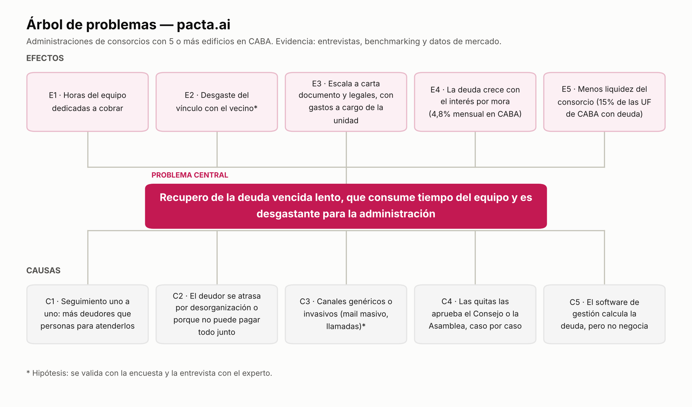

# Documentación del Proyecto: pacta.ai

> **Producto:** pacta.ai (Asistente Autónomo de Cobranzas B2B)
> **Estado:** Fase de Prototipado (MVP)

---

### Estado Actual de la Implementación

- **Estructura base:** Se ha configurado el repositorio bajo un esquema _monorepo_ (usando `pnpm`) con CI (format check, lint, typecheck, tests y build).
- **Frontend y Panel del Administrador:** Implementado en `apps/platform` con React 19, Vite, TanStack Start (SSR) y shadcn/ui (Tailwind v4). Incluye Landing Page, identidad visual, autenticación real con Supabase, protección de rutas (`_authed`) y pantallas de Deudores, Reglas del agente, Conversaciones, Acuerdos imprimibles y Configuración.
- **Backend, Base de Datos y Motor de Reglas:** _En implementación_ según [PLAN_BACKEND.md](./PLAN_BACKEND.md). Esquema PostgreSQL con RLS multi-tenant, seed de desarrollo y tests pgTAP completados (`supabase/`). Motor determinístico de reglas implementado y testeado en `packages/negotiation-engine`. Capa del agente conversacional en `packages/agent` en curso. Decisiones de arquitectura registradas en [§5.4](#54-decisiones-de-arquitectura-del-backend).
- **Gestión Documental:** Relevamiento inicial completado. Documentos como el Marco Legal, Stakeholders, Uso de IA, Entrevistas e Identidad Visual ya están definidos y consolidados en el directorio `/docs`.

---

## 1. Definición y Justificación del Problema

### 1.1 Contexto y Diagnóstico

Actualmente existe un dolor operativo significativo en las administraciones de consorcios debido a la **alta morosidad**. La gestión de cobranzas es un proceso **incómodo** y que **consume mucho tiempo**.

Los métodos tradicionales (correos electrónicos genéricos o llamadas telefónicas directas) suelen generar **fricción** o son directamente **ignorados** por los deudores. Al no contar con capacidad humana suficiente para negociar planes de pago personalizados caso por caso, las intimaciones masivas presentan una **baja tasa de respuesta** y las llamadas generan desgaste y evasión. Actualmente, el seguimiento de la mora se realiza de forma **100% manual**, ciclo a ciclo.

### 1.2 Declaración del Problema

> Los administradores de consorcios profesionales e independientes (carteras de 5 o más edificios en CABA) enfrentan la dificultad de gestionar deudas vencidas de forma manual y mediante canales genéricos. Este contacto uno a uno mensual genera una baja tasa de respuesta, desgaste en la relación interpersonal, dilatación en el recupero de la mora, y afecta negativamente la liquidez y la capacidad operativa de los consorcios.

### 1.3 Árbol de Problemas

Método de la Clase 03: causas → problema central → efectos. Cada punto indica de dónde sale: entrevistas ([ENTREVISTAS.md](./ENTREVISTAS.md)), benchmarking ([BENCHMARKING.md](./BENCHMARKING.md)) o datos de mercado. Lo que todavía no tiene evidencia se marca como hipótesis y se valida con la encuesta y la entrevista con el experto.



**Problema central:** el recupero de la deuda vencida es lento, consume tiempo del equipo y es desgastante para la administración.

**En el formato de la Clase 03:**

> Las administraciones con 5 o más consorcios en CABA tienen el problema de recuperar la deuda de expensas en forma lenta y manual cuando deben contactar y negociar con cada deudor uno por uno, lo que genera horas de trabajo, desgaste con los vecinos y menos liquidez para el consorcio.

**Causas**

| #   | Causa                                                                              | Evidencia                                                                                                                                      |
| --- | ---------------------------------------------------------------------------------- | ---------------------------------------------------------------------------------------------------------------------------------------------- |
| C1  | Seguimiento uno a uno y repetitivo: hay más deudores que personas para atenderlos. | Entrevista 2: 4 personas reparten su tiempo entre cobranzas, proveedores, atención al vecino y legales.                                        |
| C2  | El deudor se atrasa por desorganización o porque no puede pagar todo junto.        | Entrevista 2 (no siempre es falta de solvencia; a veces es desorganización). Entrevista 1 (acuerdos en cuotas cuando no tiene el monto total). |
| C3  | Canales genéricos o invasivos (mail masivo, llamadas).                             | Hipótesis. En la Entrevista 2, el canal más efectivo es la carta documento, que ya es una intimación formal. Se valida con la encuesta.        |
| C4  | Las quitas de intereses las aprueba el Consejo o la Asamblea, caso por caso.       | Entrevista 2.                                                                                                                                  |
| C5  | El software de gestión calcula la deuda, pero no negocia.                          | Benchmarking.                                                                                                                                  |

**Efectos**

| #   | Efecto                                                                                                       | Evidencia                                                                                                  |
| --- | ------------------------------------------------------------------------------------------------------------ | ---------------------------------------------------------------------------------------------------------- |
| E1  | Horas del equipo dedicadas a cobrar.                                                                         | Entrevista 2: "insistencia y seguimiento continuo". Falta medir cuántas horas (pregunta 5 de la encuesta). |
| E2  | Desgaste del vínculo con el vecino.                                                                          | Hipótesis. Indicio: en las Entrevistas 2 y 3 preocupa que el trato sea rígido o frío.                      |
| E3  | La deuda escala a carta documento y legales, con honorarios y gastos a cargo de la unidad.                   | Entrevista 2.                                                                                              |
| E4  | La deuda crece con el interés por mora (4,8% mensual en CABA) y es más difícil de regularizar.               | iProfesional (marzo 2026).                                                                                 |
| E5  | Menos liquidez del consorcio: el 15% de las UF de CABA y el 16% de las de Provincia tiene deuda de expensas. | ConsorcioAbierto, citado por Infobae (agosto 2026).                                                        |

**Preguntas de la Clase 03**

| Pregunta                              | Respuesta                                                                                                                                                                                                                           |
| ------------------------------------- | ----------------------------------------------------------------------------------------------------------------------------------------------------------------------------------------------------------------------------------- |
| ¿Existe el problema?                  | Sí. El 15% de las UF de CABA y el 16% de las de Provincia tiene deuda de expensas (ConsorcioAbierto, agosto 2026), y la Entrevista 2 (target) describe la cobranza como un seguimiento continuo y desgastante.                      |
| ¿A quién afecta?                      | A la administración (cliente), al consorcio (liquidez) y al deudor (la deuda crece).                                                                                                                                                |
| ¿Dónde?                               | CABA. Hay 122.561 consorcios (DG Rentas GCBA, agosto 2023).                                                                                                                                                                         |
| ¿Qué magnitud tiene?                  | 15% de las UF de CABA y 16% de las de Provincia con deuda; en los barrios que monitorea ConsorcioAbierto, la deuda equivale al 23% de lo liquidado (junio 2025). La mora sube con obras extraordinarias y en verano (Entrevista 2). |
| ¿Qué pasa si se resuelve? (hipótesis) | Menos horas de seguimiento, acuerdos dentro de reglas aprobadas en menos tiempo, menos casos derivados a legales y más liquidez para el consorcio.                                                                                  |

**Dónde actúa pacta.ai**

- **C1:** conversa con cada deudor, a cualquier hora, sin sumar personas al equipo.
- **C2:** le recuerda la deuda y le ofrece un plan en cuotas.
- **C3:** chat web con tono empático (WhatsApp en el Release 2).
- **C4:** aplica reglas que el Consejo o la Asamblea aprobaron de antemano, en lugar de decidir caso por caso.
- **C5:** negocia sobre la deuda que el software de gestión ya calculó.

Fuentes de los datos: ver la sección 5 de [BENCHMARKING.md](./BENCHMARKING.md) y [Pequeñas Noticias — 122.561 consorcios en CABA](https://www.pequenasnoticias.com.ar/NotasDeTapa/2023/NotaDeTapa0760.asp).

---

## 2. Segmentación y Mercado Objetivo

### 2.1 Perfilado del Cliente

El enfoque de segmentación se basa en comprender la problemática real y el estrés operativo de gestionar los cobros.

- **Geográfica:** Zonas urbanas de alta densidad en Argentina, con foco inicial en CABA. GBA queda para una etapa posterior (sección 6.5).
- **Demográfica:** Profesionales de 30–60 años. Ocupación principal: administradores de consorcios matriculados.
- **Psicográfica:** Profesionales que sufren de **estrés laboral** por la alta carga operativa y la presión del **flujo de caja**. Buscan profesionalizar la gestión manteniendo una **imagen empática** para evitar conflictos directos con vecinos o clientes.
- **Comportamiento:** Uso intensivo de planillas (Excel) o sistemas contables tradicionales. Dependencia de WhatsApp y teléfono como canales principales de seguimiento, de manera desestructurada.

### 2.2 Mercado Objetivo Primario (Target)

**Administradores de consorcios** que gestionan carteras medias/grandes (5 o más edificios simultáneamente).

> **Nota:** en la etapa inicial también se consideró como segmento a los tesoreros de colegios privados medianos (más de 300 alumnos). Luego de las entrevistas, el equipo decidió acotar el MVP solo a administraciones de consorcios (ver `Stakeholders.md`).

Este perfil absorbe personalmente la carga horaria y emocional de contactar deudores de forma manual. El producto se orienta a la entidad como cliente SaaS B2B, no al deudor final.

---

## 3. Enfoque del Producto (MVP) y Casos de Uso

### 3.1 Definición del MVP

El Producto Mínimo Viable (MVP) consiste en un **prototipo web que simula un entorno de mensajería**. Su objetivo es validar la eficacia de una negociación automatizada bajo reglas predefinidas.

- **Actor Administrador:** Carga una deuda y configura las **reglas de negociación permitidas** (ej. máximo de cuotas, quita de intereses), según lo aprobado por el Consejo de Administración o la Asamblea.
- **Actor Deudor:** Interactúa en lenguaje natural para negociar su deuda.
- **Sistema:** Procesa las solicitudes del deudor y ofrece un **acuerdo formal** estrictamente dentro de las políticas configuradas por la administración.

### 3.2 Propuesta de Valor

El valor del sistema no radica únicamente en contar con un chatbot, sino en la integración de la **deuda + las reglas de negociación aprobadas por el consorcio + el diálogo**.

- **Para la administración:** delega el contacto y la negociación inicial con cada deudor (la tarea que más trabajo le ahorraría, según la Entrevista 1) y recibe acuerdos trazables, sin tener que confrontar a los vecinos.
- **Para el consorcio:** el agente solo ofrece las condiciones que aprobó el Consejo de Administración o la Asamblea. La administración las carga en la plataforma y el agente no puede salirse de ellas.
- **Para el deudor:** un canal claro y respetuoso para entender su deuda y proponer un plan de pago, con derivación a una persona cuando lo necesita.

**Quién define las reglas:** según la Entrevista 2, la administración no decide por sí sola las quitas ni la reducción de intereses: las autoriza el Consejo de Administración o la Asamblea. Por eso el producto no reemplaza esa decisión; ejecuta de forma automatizada y trazable las condiciones ya aprobadas, y cualquier pedido fuera de ellas se deriva a una persona.

Así, cada acuerdo queda registrado y dentro de lo aprobado, y el personal se libera del desgaste de la negociación directa.

### 3.3 Alcance Excluido

El producto **no es**:

- Un sistema de liquidación de expensas mensuales regulares.
- Un portal de pago genérico.
- El enfoque está exclusivamente en la **negociación de deudas vencidas y la mora**, no en el alta de unidades funcionales ni la facturación recurrente.

### 3.4 Casos de Uso Principales (Jobs to be Done)

- **Funcional:** Registrar deudas, aplicar reglas de flexibilidad y procesar deudores en paralelo para llegar a acuerdos escritos y trazables.
- **Emocional:** Disminuir el estrés de la carga operativa y la frustración de gestionar cobros manualmente sin obtener respuesta.
- **Social:** Preservar la relación interpersonal (evitar el rol del "vecino que persigue") manteniendo una imagen empática y profesional frente a la comunidad.

---

## 4. Investigación de Usuarios

### 4.1 Objetivo

Resolver la siguiente premisa: _¿Cómo podríamos ayudar a un administrador de consorcios, bajo presión de caja y con miedo al conflicto, a cerrar acuerdos de pago dentro de su política sin que cada mora se convierta en una confrontación manual?_

### 4.2 Arquetipo de Usuario (Persona)

- **Perfil:** "El encargado de recuperar el mes".
- **Escenario:** Cierre de mes con saldos vencidos. Se ve obligado a usar el teléfono y WhatsApp personal para contactar deudores de manera desorganizada.
- **Motivaciones:** Recuperar la caja en positivo sin desgastar la relación con el deudor.
- **Frustraciones:** Evasión por parte del deudor, pérdida de tiempo, respuestas nulas a los correos, y el impacto emocional de la cobranza directa.

### 4.3 Mapa de Empatía (Resumen)

- **Piensa y siente:** Preocupación por cubrir costos fijos (proveedores, sueldos); considera que "cobrar es incómodo"; desea modernizar sus herramientas.
- **Esfuerzos:** Pierde tiempo en tareas repetitivas; las comunicaciones masivas no son efectivas.
- **Resultados esperados:** Acuerdos documentados, recupero de capital sin conflicto cara a cara y optimización del tiempo laboral.

---

## 5. Alcance y Arquitectura Tecnológica

### 5.1 Componentes del Sistema

- **Plataforma (SaaS):** Entorno multi-tenant donde el cliente inicia sesión, gestiona las carteras de deudores, configura el agente y visualiza métricas de recupero.
- **Agente Conversacional:** Motor de IA (Sandbox en etapa MVP) que gestiona el estado de la conversación y negocia mediante lenguaje natural.

### 5.2 Stack Tecnológico

- **Frontend / Plataforma:** React 19 + TanStack Start (Router + SSR) + Vite.
- **UI Components:** shadcn/ui, Base UI y Tailwind CSS v4 para el diseño de componentes, efectos (como `hero-shader-gradient`) y estilos estandarizados.
- **IA y Agente:** Vercel AI SDK implementando **GPT-5.6 Luna** en `packages/agent` (system prompt versionado, tools tipadas con Zod y `runNegotiationTurn`), respaldado por el motor determinístico `packages/negotiation-engine`.
- **Backend / Auth:** Supabase (Auth + Base de datos relacional PostgreSQL con RLS multi-tenant).

> **Decisión Técnica - Modelo de IA:** Se seleccionó **GPT-5.6 Luna** como modelo fundacional priorizando su robustez en el cumplimiento estricto de system prompts (guardrails) para evitar "alucinaciones" (como otorgar descuentos no permitidos por la administración), además de contar con excelentes capacidades de _Function Calling_ y un balance ideal de costo/velocidad.

### 5.3 Arquitectura de Monorepo

El código se organiza para separar las responsabilidades lógicas entre la aplicación web (UI + servidor), el agente de IA y el motor de reglas, utilizando `pnpm` como gestor de paquetes de monorepo:

```text
├── apps/
│   └── platform/                 # Landing, panel admin, chat del deudor y backend (server functions/routes de TanStack Start)
│       ├── src/
│       ├── public/
│       └── package.json
├── packages/
│   ├── agent/                    # Agente conversacional: prompt, tools y orquestación (Vercel AI SDK)
│   └── negotiation-engine/       # Motor de reglas determinístico (puro, sin IO)
├── supabase/                     # Configuración, migraciones SQL y seed
├── docs/                         # Documentación del proyecto
├── tsconfig.base.json
├── pnpm-workspace.yaml
└── package.json
```

### 5.4 Decisiones de Arquitectura del Backend

Detalle y alternativas evaluadas en [PLAN_BACKEND.md §1](./PLAN_BACKEND.md#1-decisiones-arquitectónicas).

| #   | Decisión                                                                                                                                                                                      | Justificación                                                                                                                                                                           |
| :-- | :-------------------------------------------------------------------------------------------------------------------------------------------------------------------------------------------- | :-------------------------------------------------------------------------------------------------------------------------------------------------------------------------------------- |
| D1  | El backend vive dentro de `apps/platform` (server functions y server routes de TanStack Start). El agente es una librería (`packages/agent`) en lugar de un servicio separado (`apps/agent`). | Un solo deploy, sesión compartida y tipos end‑to‑end para un equipo de 5. Al ser librería, en R2 se monta detrás de un webhook de WhatsApp sin reescribirse.                            |
| D2  | Acceso a datos con supabase-js + `@supabase/ssr`, migraciones SQL con Supabase CLI y tipos generados.                                                                                         | El RLS se aplica con la sesión del usuario, cumpliendo el aislamiento de carteras exigido por el [Marco Legal](./MARCO_LEGAL.md).                                                       |
| D3  | `organization_id` + Row Level Security desde el MVP, sin registro público (alta por seed o invitación) y un único rol de usuario.                                                             | Costo bajo ahora y migración cara después; requisito de la LPDP.                                                                                                                        |
| D4  | El deudor accede por un link único tokenizado y debe verificar su identidad antes de ver montos; luego recibe una cookie firmada de corta duración.                                           | Evita exponer la deuda a terceros (Ley 6.171 CABA, Art. 26 LPDP). Es el mismo flujo que tendrá WhatsApp en R2.                                                                          |
| D8  | El LLM se consume en la nube vía Vercel AI Gateway; el modelo se configura por variable de entorno.                                                                                           | Function calling confiable, deploy sin infraestructura de GPU y posibilidad de cambiar de modelo sin tocar código. La privacidad se mitiga minimizando datos personales en los prompts. |

---

## 6. Modelo de Negocios

### 6.1 Estructura de Ingresos

El modelo de cobro combina dos componentes. Los valores son hipótesis iniciales para el MVP y se ajustan con la encuesta a administradores (preguntas 10 a 13).

1.  **Abono mensual en pesos, escalonado por cantidad de consorcios administrados.**
    - Hipótesis para el primer escalón: **ARS 23.500 por mes** (unos USD 15 al dólar oficial del BNA del 02/11/2026). Los escalones siguientes se definen con la encuesta.
    - Referencia: los software de gestión de consorcios cobran un abono mensual por unidad funcional, de ARS 950 a 2.950 por UF (CONSO, agosto 2026). Una administración de 150 UF paga hoy entre ARS 140.000 y 440.000 por mes.
2.  **Comisión porcentual sobre el monto efectivamente cobrado** de los acuerdos que cerró el agente (no sobre el acuerdo firmado: solo se cobra cuando el deudor paga).
    - Hipótesis: **3%**, dentro de un rango de 1,5% a 3% a validar.
    - Referencia: la CAPHAI sugiere un arancel de ARS 161.000 por convenio de pago por deuda de expensas (tabla octubre/noviembre 2026). Con 3%, cobrar una deuda de ARS 1.000.000 cuesta ARS 30.000.

**Alternativas descartadas:**

- _Solo suscripción fija:_ el administrador asume todo el costo aunque el agente todavía no recupere nada; frena la prueba inicial.
- _Solo comisión por éxito:_ sin recupero inmediato no hay ingreso que cubra la operación mensual.
- _Precio por conversación o por mensaje:_ hace impredecible el gasto mensual del administrador y penaliza que el agente insista o negocie en varios turnos.
- _Cobro en USD:_ los administradores cobran honorarios y expensas en ARS; fijar el precio en dólares traslada riesgo cambiario al cliente en cada ajuste.

**Justificación:**

- **Utilidad:** El agente automatiza el contacto con el deudor y la negociación inicial, la etapa que en la Entrevista 1 se señaló como la que más trabajo ahorraría. Ninguno de los software de consorcios relevados ofrece negociar planes de pago.
- **Precio:** Queda por debajo de las alternativas actuales: el arancel por convenio manual y el abono de un software de gestión.
- **Costo:** El costo variable del MVP (chat web) se estima en **USD 0,015 por negociación** con GPT-5.6 Luna (USD 0,20 por millón de tokens de entrada y USD 1,20 de salida), suponiendo un prompt base de ~1.200 tokens, 10 turnos y 2 pasos por turno. Aun con un error de 10 veces, son USD 0,15. Con WhatsApp (Release 2) se suma la plantilla del primer contacto, estimada en USD 0,012–0,03 por mensaje (la tarifa oficial para Argentina no está confirmada); las respuestas dentro de la ventana de 24 horas no tienen costo.
- **Adopción:** Con la comisión, el cliente paga principalmente cuando recupera. La Entrevista 1 mencionó preferir una combinación de abono y comisión (es un indicio, no una validación).

**Riesgo abierto:** La comisión se calcula sobre fondos del consorcio, no del administrador. Según la Entrevista 2, las excepciones las autoriza el Consejo de Administración o la Asamblea, por lo que cobrarla podría requerir esa aprobación. Se valida con la encuesta (preguntas 10 a 13).

### 6.2 Costos del MVP

| Concepto                     | Costo                                                                                                                          | Fuente                               |
| ---------------------------- | ------------------------------------------------------------------------------------------------------------------------------ | ------------------------------------ |
| Hosting (Vercel Pro)         | USD 20 por mes                                                                                                                 | Vercel                               |
| Base de datos (Supabase Pro) | USD 25 por mes                                                                                                                 | Supabase                             |
| IA (GPT-5.6 Luna)            | ~USD 0,015 por negociación. Una administración de 150 UF con 15% de morosidad (unos 23 deudores) genera unos USD 0,35 por mes. | OpenAI y estimación propia (ver 6.1) |
| **Total fijo**               | **≈ USD 45 por mes**                                                                                                           |                                      |

No incluye sueldos, marketing, impuestos ni costos de cobro: en el TIF el equipo trabaja sin costo. En una operación real esos costos se suman y mueven el punto de equilibrio.

### 6.3 Punto de Equilibrio

Con el abono del primer escalón (ARS 23.500, unos USD 15), **4 administraciones** cubren la infraestructura: 4 × USD 15 = USD 60, frente a unos USD 46 de costo (fijo más IA). La comisión queda como margen: cada ARS 1.000.000 recuperado aporta ARS 30.000.

### 6.4 Tamaño de Mercado

- **Consorcios en CABA:** 122.561 (DG Rentas GCBA, agosto 2023).
- **Administradores activos en CABA:** 8.505, según el CSV del Registro Público de Administradores que el GCBA publica en BA Data (corte 25/02/2026). Fuente secundaria: un repositorio público que procesa ese dataset.
- **Administraciones con 5 o más consorcios (target):** no hay dato oficial. Se estima con la encuesta (pregunta 2).
- **Referencia:** ConsorcioAbierto, la plataforma más grande relevada, trabaja con unos 15.000 consorcios (Infobae, agosto 2026) y unos 1.500 administradores (El Cronista, agosto 2025).
- **GBA (etapa posterior):** no se encontró un dato público de inscriptos en el registro provincial de administradores (Ley 14.701).
- **Objetivo del año 1:** 30 administraciones, un 0,35% de los administradores activos de CABA. Es una meta del equipo, no una proyección.

### 6.5 Crecimiento

- **Release 2 — WhatsApp:** es el canal que más usan las administraciones según las 3 entrevistas. Suma USD 0,012–0,03 por la plantilla del primer contacto.
- **Release 3 — Integración con software de gestión:** además de una función, puede ser un canal de venta a los clientes de esos software.
- **Nuevas zonas:** GBA y otras ciudades con alta densidad de consorcios.
- **Nuevos segmentos:** colegios privados, descartados para el MVP después de las entrevistas.

**Fuentes de la sección 6:** [Vercel — plan Pro](https://vercel.com/docs/plans/pro-plan), [Supabase — precios](https://supabase.com/pricing), [OpenAI — GPT-5.6 Luna](https://developers.openai.com/api/docs/models/gpt-5.6-luna), [Pequeñas Noticias — 122.561 consorcios en CABA](https://www.pequenasnoticias.com.ar/NotasDeTapa/2023/NotaDeTapa0760.asp), [Repositorio sobre el registro de administradores de CABA](https://github.com/PabloAlaniz/administradores-consorcios-caba), [Infobae — morosidad en expensas (agosto 2026)](https://www.infobae.com/economia/2026/08/19/la-morosidad-en-las-expensas-alcanzo-el-15-en-caba-y-el-16-en-la-provincia-de-buenos-aires/), [El Cronista — ConsorcioAbierto](https://www.cronista.com/apertura/emprendedoress/una-startup-argentina-puso-las-expensas-bajo-control-y-conquisto-a-manu-ginobili).

### 6.6 Posicionamiento (Elevator Pitch)

> "Actualmente, los administradores de consorcios sufren un gran desgaste cada cierre de mes al perseguir a los deudores uno por uno, enfrentándose a correos ignorados y llamadas incómodas que tensionan las relaciones y afectan la liquidez.
> Hemos desarrollado un asistente autónomo de cobranzas B2B. El administrador simplemente carga la deuda y sus límites de negociación, y nuestro agente dialoga con el deudor en lenguaje natural para cerrar un acuerdo por escrito, siempre dentro de las políticas de la institución. El resultado es un mayor recupero de mora, de manera empática, trazable y sin confrontaciones manuales."

---

## 7. Roadmap y Evolución del Producto

### 7.1 Grilla de Priorización

| Prioridad         | Esfuerzo   | Impacto  | Componentes Core                                                                                                                              |
| :---------------- | :--------- | :------- | :-------------------------------------------------------------------------------------------------------------------------------------------- |
| **Alta (MVP)**    | Bajo/Medio | Alto     | Chatbot web simulado, módulo de reglas de negociación, registro de deudas, emisión de acuerdo en texto.                                       |
| **Media (V2)**    | Alto       | Alto     | Integración oficial con WhatsApp Business API, generación de links de pago dinámicos, carga masiva (CSV).                                     |
| **Baja (Futuro)** | Medio      | Bajo     | Dashboards avanzados predictivos, sincronización bidireccional vía API con sistemas contables ERP de terceros.                                |
| **Excluido**      | Alto       | Negativo | Llamadas telefónicas robóticas (hostigamiento), desarrollo de un ERP completo de liquidación de expensas, score crediticio predictivo propio. |

### 7.2 Plan de Lanzamientos (Releases)

1.  **Release 1 (MVP - Sandbox):** Interfaz web simulada. Carga manual de parámetros. Diálogo de negociación asistida y emisión de acta de acuerdo de pago.
2.  **Release 2 (Operación Real):** Integración con WhatsApp Cloud API para interacción real, arquitectura multi-tenant, importación masiva de deudores, y envíos de links de pago transaccionales.
3.  **Release 3 (Ecosistema Integrado):** Omnicanalidad, conexión mediante API a software de gestión de expensas para conciliación automática de pagos.

---

## 8. Estrategia de Mercado y Posicionamiento

### 8.1 Diagnóstico Competitivo

El mercado tradicional de recuperación de deuda se caracteriza por prácticas invasivas (estudios jurídicos, llamadas reiterativas, intimaciones). Este enfoque intimida al deudor, genera rechazo y daña la reputación de la entidad acreedora.

### 8.2 Diferenciación

pacta.ai se diferencia por lo que hace con cada factor de la curva de valor (detalle en [ERIC.md](./ERIC.md)):

- **Elimina:** la gestión contable de la deuda. La resuelve el software que el consorcio ya usa.
- **Reduce:** el precio para la administración, los recordatorios automáticos y la integración de pagos (quedan para los Releases 2 y 3).
- **Incrementa:** la atención 24/7 al deudor, el ahorro de tiempo del equipo y el cuidado del vínculo con el vecino.
- **Crea:** la negociación automatizada de planes de pago, dentro de reglas aprobadas por el Consejo o la Asamblea y con cada acuerdo registrado.

**Lema:** "De la deuda al acuerdo."

### 8.3 Barreras de Entrada

El sistema posee ventajas sostenibles a mediano plazo:

- **Alineación Tecnológica y Cultural:** El producto combina automatización por IA con un tono conversacional altamente calibrado.
- **Renovación Constante:** El roadmap incluye automatizaciones más complejas (integración bancaria y contable) que elevarán los costos de cambio para el cliente, asegurando retención a largo plazo.

---

## Backlog del Equipo (Próximos Pasos)

1.  **Validación de Datos:** Relevar métricas del sector inmobiliario (consorcios) para respaldar la magnitud del problema de la morosidad.
2.  **Investigación de Usuarios:** Difundir y analizar la encuesta cuantitativa para validar perfiles y consolidar los mapas de empatía reales.
3.  **Definiciones de Arquitectura:** Cerrar la selección del router web y la arquitectura exacta de Supabase para el Release 2.
4.  **Guardrails de IA:** Implementar políticas de seguridad y _prompts_ restrictivos para garantizar que el modelo no ofrezca descuentos o planes no autorizados.
5.  **Definición Comercial:** Validar con la encuesta el rango de comisión, el monto del abono y quién absorbe la comisión (administración o consorcio).
6.  **Gestión de Claves:** Implementar rotación y administración segura de variables de entorno para las APIs utilizadas en el proyecto.
