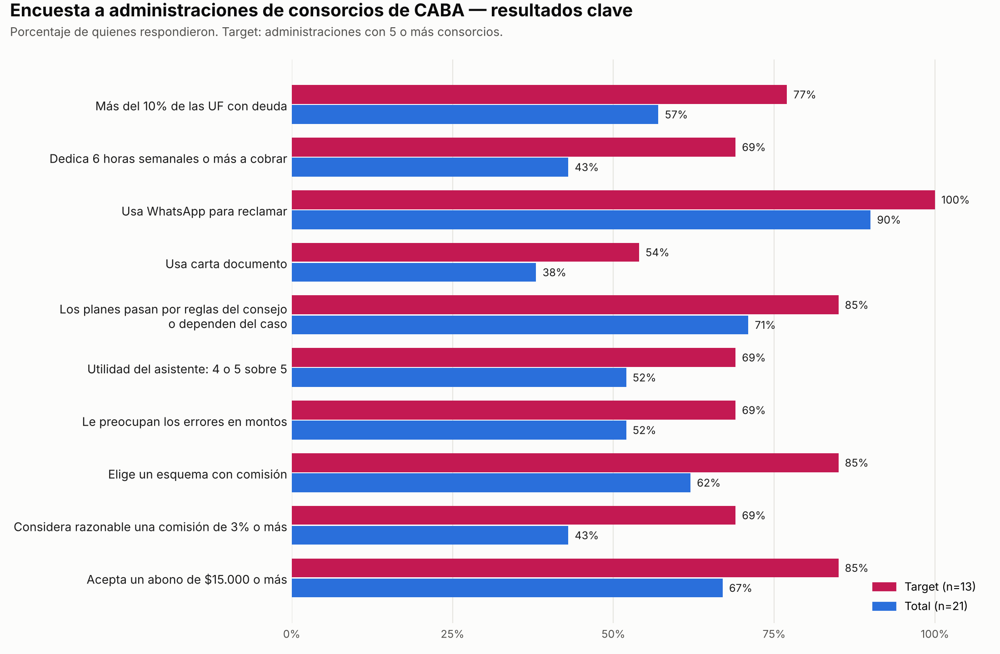

# Encuesta a Administraciones de Consorcios (CABA)

Encuesta cuantitativa para validar el problema, el circuito de aprobación de los planes de pago, la utilidad del asistente y el modelo de cobro (Clase 06 — encuesta difundida con respuestas y análisis).

---

## 1. Ficha Técnica

| Campo         | Detalle                                                                                                                                      |
| ------------- | -------------------------------------------------------------------------------------------------------------------------------------------- |
| Formulario    | [Google Forms — Encuesta pacta.ai CABA](https://docs.google.com/forms/d/e/1FAIpQLSeRGpfaW0PYFvtKBnBtGUtHB1QRnZNZHlftlQyADtpR90otig/viewform) |
| Destinatarios | Administraciones de consorcios que operan en CABA                                                                                            |
| Respuestas    | 21 (13 dentro del target: administraciones con 5 o más consorcios)                                                                           |
| Período       | Septiembre a noviembre de 2026                                                                                                               |
| Cuestionario  | 14 preguntas cerradas y un campo de comentarios opcional. Anónima.                                                                           |

---

## 2. Perfil de Quienes Respondieron

- **Rol:** 13 administradores/as (62%), 6 integrantes del personal de una administración (29%) y 2 miembros de consejos de propietarios (10%).
- **Consorcios en CABA:** 1 consorcio, 3; entre 2 y 4, 5; entre 5 y 10, 7; entre 11 y 25, 4; más de 25, 2. **Target: 13 de 21 (62%).**
- **Jurisdicción:** 16 operan solo en CABA y 5 también en otras jurisdicciones; estos últimos respondieron por su cartera de CABA.

---

## 3. Resultados

| Indicador                                                                            | Target (n=13) | Total (n=21) |
| ------------------------------------------------------------------------------------ | :-----------: | :----------: |
| Más del 10% de las UF con al menos una expensa vencida (último mes cerrado)          |      77%      |     57%      |
| Dedica 6 horas semanales o más a contactar y seguir deudores                         |      69%      |     43%      |
| Usa WhatsApp para reclamar                                                           |     100%      |     90%      |
| Usa carta documento                                                                  |      54%      |     38%      |
| Deriva a estudio jurídico                                                            |      38%      |     24%      |
| Los planes pasan por reglas del consejo, el consejo, la asamblea o dependen del caso |      85%      |     71%      |
| Utilidad del asistente: 4 o 5 sobre 5                                                |      69%      |     52%      |
| Le preocupan los errores en montos o condiciones                                     |      69%      |     52%      |
| Le preocupa el tono hacia los vecinos                                                |      46%      |     38%      |
| Elige abono + comisión o solo comisión                                               |      85%      |     62%      |
| Considera razonable una comisión de 3% o más                                         |      69%      |     43%      |
| Acepta un abono mensual de $15.000 o más                                             |      85%      |     67%      |

**Forma de pago preferida (target):** abono bajo + comisión, 46%; solo comisión, 38%; pago por uso, 15%. Ninguna administración del target respondió "no pagaría".

**Comisión considerada razonable (target):** 2%, 31%; 3%, 54%; 5%, 15%.

**Abono mensual considerado razonable (target):** hasta $15.000, 15%; entre $15.000 y $30.000, 31%; entre $30.000 y $60.000, 31%; más de $60.000, 23%.

---

## 4. Hallazgos

1. **El problema está en el target.** El 77% tiene más del 10% de sus unidades con deuda y el 69% dedica 6 horas semanales o más a cobrar.
2. **Las reglas pasan por el consejo.** En el 85% del target, los planes de pago dependen de reglas del consejo, del consejo o la asamblea, o del caso. Respalda que pacta.ai negocie con reglas aprobadas de antemano.
3. **La principal preocupación es la precisión.** El 69% del target teme errores en montos o condiciones. Respalda el pre-acuerdo revisado por una persona y la trazabilidad.
4. **El modelo de cobro es aceptado.** El 85% del target elige un esquema con comisión. La comisión del 3% y el abono de ARS 23.500 están dentro de lo que considera razonable la mayoría del target.
5. **Quién absorbe el costo.** El 62% del target responde que el deudor, como gasto de gestión; el 31%, la administración.
6. **El foco en 5 o más consorcios se sostiene.** Fuera del target la utilidad baja (ninguna respuesta de 5) y aparecen las únicas respuestas "no pagaría".
7. **WhatsApp es el canal de todo el target.** Respalda el Release 2.

**Comentarios destacados:**

- "Lo que más tiempo nos lleva es seguir a los que prometen pagar y no pagan."
- "Los planes de pago siempre pasan por el consejo y eso demora todo."
- "Nos interesaría que se integre con el sistema de liquidación que ya usamos." (Release 3)

---

## 5. Qué Hipótesis Actualiza

| Hipótesis                                            | Antes        | Con la encuesta                                                                |
| ---------------------------------------------------- | ------------ | ------------------------------------------------------------------------------ |
| E1 — Horas del equipo dedicadas a cobrar             | Sin dato     | 69% del target dedica 6 horas semanales o más                                  |
| C4 — Las quitas las aprueba el Consejo o la Asamblea | Entrevista 2 | 85% del target depende de reglas del consejo o del caso                        |
| E2 — Desgaste del vínculo con el vecino              | Hipótesis    | Indicio: al 46% del target le preocupa el tono hacia los vecinos               |
| Utilidad del asistente                               | Entrevistas  | 69% del target la califica con 4 o 5                                           |
| Modelo de cobro (abono + comisión del 3%)            | Entrevista 1 | 85% elige esquemas con comisión; 69% acepta 3% o más; 85% acepta $15.000 o más |
| Target: administraciones con 5 o más consorcios      | Hipótesis    | Mayor utilidad y disposición a pagar que fuera del target                      |

---

## 6. Cuestionario

1. ¿Su administración gestiona consorcios en CABA?
2. ¿Cuál es su rol?
3. ¿Cuántos consorcios administran en CABA?
4. ¿Cuántas unidades funcionales gestionan en CABA, aproximadamente?
5. En el último mes cerrado, ¿qué porcentaje aproximado de unidades funcionales de CABA tuvo al menos una expensa vencida?
6. ¿Cuántas horas semanales dedica el equipo a contactar y seguir deudores de consorcios ubicados en CABA?
7. ¿Qué canales usan para reclamar deudas?
8. Cuando un deudor pide un plan de pagos o una quita de intereses, ¿quién lo aprueba?
9. ¿Qué tan útil le resultaría una herramienta así? (1 a 5)
10. ¿Qué le preocuparía de usarla?
11. ¿Qué forma de pago le parecería más razonable?
12. ¿Qué comisión sobre lo efectivamente recuperado le parecería razonable?
13. ¿Cuánto le parecería razonable pagar de abono mensual por toda la administración?
14. ¿Quién cree que debería absorber ese costo?
