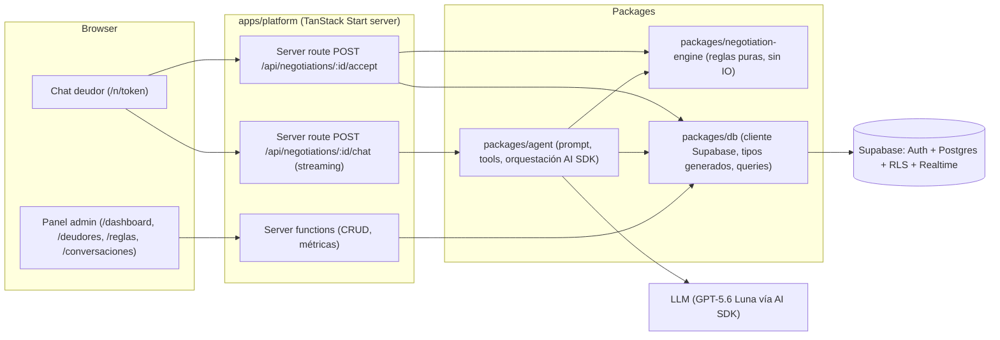
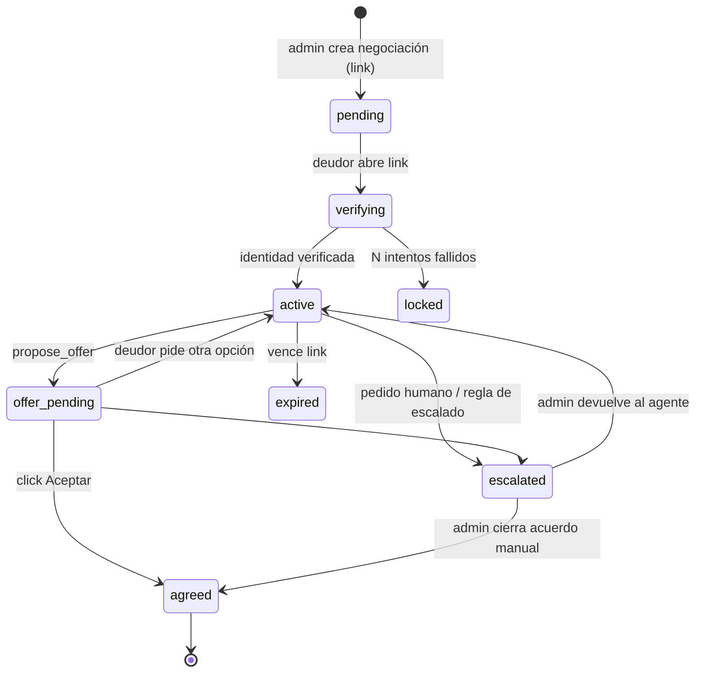
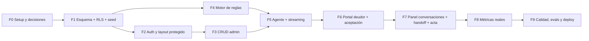

# Plan de Implementación — Backend MVP pacta.ia

> **Alcance:** todo lo necesario del lado servidor para cumplir el **Release 1 (MVP – Sandbox)** definido en [DOCUMENTACION.md](./DOCUMENTACION.md#L56-L76) y [§7.2](./DOCUMENTACION.md#L158-L161), más la conexión con el prototipo de `apps/platform`.

---

## 0. Diagnóstico del repositorio

| Área | Estado actual | Implicancia |
| :--- | :--- | :--- |
| Monorepo | pnpm, `apps/*` y `packages/*` declarados en [pnpm-workspace.yaml](../pnpm-workspace.yaml). `packages/` **no existe**. | Hay lugar para paquetes compartidos sin reestructurar nada. |
| `apps/platform` | TanStack Start (SSR) + React 19 + shadcn. Rutas: `/`, `/login`, `/dashboard`. **No hay ninguna server function, server route ni dependencia de backend**. | El servidor de TanStack Start ya está disponible y es el lugar natural para el backend. |
| Login | [login.tsx](../apps/platform/src/routes/login.tsx#L15-L18) navega a `/dashboard` sin autenticar. | Hay que reemplazarlo por Auth real y proteger rutas. |
| Dashboard | Todos los datos están hardcodeados: [dashboard-overview.tsx](../apps/platform/src/components/dashboard/dashboard-overview.tsx#L24-L67), [recovery-trend-chart.tsx](../apps/platform/src/components/dashboard/recovery-trend-chart.tsx#L18-L25), [agreement-plans-chart.tsx](../apps/platform/src/components/dashboard/agreement-plans-chart.tsx#L20-L24). | Define el contrato de métricas que el backend debe exponer. |
| Navegación | [app-sidebar.tsx](../apps/platform/src/components/app-sidebar.tsx#L26-L34): "Conversaciones", "Deudores", "Reglas del agente", "Configuración" deshabilitados; org ("Consorcios del Sur") y usuario ("Simon") hardcodeados. Botón "Nueva negociación" sin acción. | Mapa directo de las pantallas/endpoints que faltan. |
| `apps/agent` | Solo un [README](../apps/agent/README.md) ("Stack and tools are TBD"). | Decisión pendiente (ver D1). |
| Stack declarado | Supabase (Auth + Postgres) y Vercel AI SDK con GPT‑5.6 Luna, ambos *pendientes*. | Se respeta como base. |
| Requisitos legales | [MARCO_LEGAL.md](./MARCO_LEGAL.md) exige: RLS multi-tenant, bot disclosure, LLM sin cálculo libre de montos (function calling + validación determinística), human‑in‑the‑loop, verificación de identidad, evidencia del acuerdo (timestamp, IP, aceptación explícita, hash), minimización de PII en prompts. | Son requisitos **funcionales** del backend, no "nice to have". |
| Higiene | Dependencias `"latest"` en `package.json`; `.env*` ya ignorado. | Fijar versiones antes de empezar (evita roturas de TanStack Start entre releases). |

---

## 1. Decisiones arquitectónicas pendientes

Cada decisión tiene una **recomendación** (⭐). Las marcadas con 🔴 bloquean el inicio de la Fase 1.

### D1 🔴 — ¿Dónde vive el backend?

| Opción | Pros | Contras |
| :--- | :--- | :--- |
| ⭐ **A. Backend dentro de `apps/platform`** (server functions + server routes de TanStack Start) y lógica de dominio en **paquetes** (`packages/*`) | Un solo deploy, sesión/cookies compartidas, tipos end‑to‑end, sin CORS. Ideal para un equipo de 5 y un MVP. | Acopla el ciclo de deploy de UI y agente. |
| B. Servicio separado en `apps/agent` (Hono/Fastify) | Escala/deploy independiente; listo para webhooks de WhatsApp (R2). | Duplica auth, CORS, dos deploys, más infra para un sandbox. |

**Recomendación:** A. `apps/agent` se convierte en **`packages/agent`** (librería pura: prompt, tools, orquestación) para que en R2 pueda montarse detrás de un webhook sin reescribir nada.

### D2 🔴 — Acceso a datos

| Opción | Detalle |
| :--- | :--- |
| ⭐ **supabase-js + `@supabase/ssr` + migraciones SQL con Supabase CLI + tipos generados** | RLS real aplicado por la sesión del usuario (requisito legal), menos capas. |
| Drizzle ORM sobre conexión Postgres directa | Mejor DX de queries, pero la conexión directa **saltea RLS** salvo configuración extra; duplica el modelo de seguridad. |

### D3 🔴 — Multi‑tenancy en el MVP

La doc ubica "arquitectura multi‑tenant" en R2, pero el dashboard ya muestra una organización. **Recomendación:** modelar `organization_id` + RLS **desde el día 1** (costo bajo ahora, migración cara después), sin UI de gestión de organizaciones: alta por seed/invitación manual.

### D4 🔴 — ¿Cómo accede el deudor al chat simulado?

| Opción | Detalle |
| :--- | :--- |
| ⭐ **Link único tokenizado** `/n/$token` + **verificación de identidad** (ej. últimos 3 dígitos del DNI o código enviado) antes de mostrar montos | Cumple Ley 6.171 / LPDP (no exponer deuda a terceros). Es exactamente el flujo que tendrá WhatsApp en R2. |
| Solo "modo simulación" dentro del dashboard (el admin juega de deudor) | Más simple, pero no valida la experiencia del deudor ni la verificación. |

**Recomendación:** ambos. El link público es el flujo real; el modo simulación es un botón "Probar como deudor" que reutiliza el mismo endpoint (útil para demo y para que el admin pruebe sus reglas).

### D5 — Modelo de reglas de negociación (qué parámetros configura el admin)

Propuesta mínima, validada contra [ENTREVISTAS.md](./ENTREVISTAS.md) y el dashboard (planes de 1–3 cuotas):

| Parámetro | Tipo | Ejemplo |
| :--- | :--- | :--- |
| `max_installments` | int | 3 |
| `min_down_payment_pct` | % | 20 |
| `min_installment_amount` | moneda | $ 20.000 |
| `max_interest_waiver_pct` (cuotas) | % | 50 |
| `single_payment_interest_waiver_pct` | % | 100 |
| `max_principal_discount_pct` | % | 0 (el capital no se toca por defecto) |
| `max_first_due_days` | int | 15 |
| `offer_validity_hours` | int | 72 |
| `escalate_above_amount` | moneda | $ 1.000.000 → requiere humano |
| `tone` / `custom_instructions` | enum / texto acotado | "empático‑formal" |

Decisiones derivadas: **política por organización con override por deuda** (⭐) y **versionado inmutable** (cada negociación guarda un *snapshot* de la política usada → trazabilidad).

### D6 — Representación monetaria e intereses

⭐ Montos en **centavos `bigint`** (ARS, sin flotantes). Intereses: el admin carga `principal` e `interés acumulado` al momento de crear la deuda (sin motor de devengamiento en el MVP). Cuotas **sin interés de financiación** en el MVP (simplifica y es lo que muestran las entrevistas). Revisar topes del Decreto 2417/93 para colegios en R2.

### D7 — Diseño del agente (guardrail central)

⭐ **El LLM nunca produce montos.** Toda cifra sale del motor de reglas determinístico vía *tools*; la oferta se persiste en DB y el frontend renderiza una **tarjeta de oferta** desde la DB (no desde el texto del modelo). La **aceptación es un click del deudor** sobre esa tarjeta (endpoint dedicado), nunca una tool del LLM. Ver §3.

### D8 — Proveedor/modelo y gateway

Docs fijan GPT‑5.6 Luna vía Vercel AI SDK. Decidir: provider directo (`@ai-sdk/openai`) vs **Vercel AI Gateway** (⭐ si se deploya en Vercel: fallback de modelos, observabilidad y control de costos sin código extra). En ambos casos el modelo se inyecta por config para poder testear con `MockLanguageModel`.

### D9 — Handoff humano y tiempo real

Cuando el deudor pide "hablar con una persona" o el motor escala, la negociación pasa a `escalated` y el admin puede escribir desde el panel. ¿Cómo le llegan esos mensajes al deudor?
- ⭐ **Supabase Realtime** sobre la tabla `messages` (canal por negociación, autorizado por token).
- Alternativa más simple: polling cada 5 s en estado `escalated`.

### D10 — Métrica "Monto recuperado"

El dashboard muestra "Monto recuperado", pero **el MVP no procesa pagos** (links de pago son R2). Opciones:
- ⭐ Mostrar **"Monto acordado"** (comprometido en actas) + permitir al admin **marcar cuotas como pagadas** manualmente → "Monto recuperado" real y base para la comisión por éxito.
- Renombrar la tarjeta a "Monto acordado" y posponer el seguimiento de cuotas.

### D11 — Documento del acuerdo

⭐ Acta en **HTML imprimible / "Guardar como PDF"** generada desde una plantilla versionada, con: partes, plan, cronograma, `accepted_at`, IP, user‑agent, **SHA‑256 del transcript** y versión de política. PDF server‑side (`@react-pdf/renderer`) y envío por mail quedan como opcionales.

### D12 — Deploy y entornos

⭐ **Vercel** (soporte nativo de TanStack Start y streaming del AI SDK) + **Supabase Cloud** (proyecto `dev` y `prod`; local con `supabase start`). Variables: `SUPABASE_URL`, `SUPABASE_ANON_KEY`, `SUPABASE_SERVICE_ROLE_KEY` (solo servidor), `AI_GATEWAY_API_KEY`/`OPENAI_API_KEY`, `NEGOTIATION_TOKEN_SECRET`.

---

## 2. Arquitectura propuesta



### Estructura de carpetas objetivo

```text
apps/
  platform/
    src/
      routes/
        _authed.tsx                 # layout protegido (beforeLoad → sesión)
        _authed/dashboard.tsx
        _authed/deudores/index.tsx, $debtorId.tsx
        _authed/conversaciones/index.tsx, $negotiationId.tsx
        _authed/reglas.tsx
        _authed/acuerdos/$agreementId.tsx
        n/$token.tsx                # chat público del deudor
        api/negotiations/$id/chat.ts
        api/negotiations/$id/accept.ts
      server/                       # server functions por dominio
        auth.ts  debtors.ts  policies.ts  negotiations.ts  metrics.ts
packages/
  db/                 # supabase client factories (user / service), types.gen.ts, queries
  negotiation-engine/ # validatePlan, buildOffer, schedule, money utils + tests
  agent/              # systemPrompt, tools, runNegotiationTurn()
  shared/             # Zod schemas y tipos DTO compartidos front/back
supabase/
  migrations/  seed.sql  config.toml
```

---

## 3. Diseño del agente y motor de reglas

### 3.1 Motor de reglas (`packages/negotiation-engine`) — puro y 100 % testeado

- `getNegotiationBounds(debt, policy)` → rangos permitidos (cuotas min/max, anticipo mínimo, quita máxima según modalidad).
- `evaluateRequest(debt, policy, request)` → `{ ok: true, offer } | { ok: false, reason, closestValidOffer }`. Nunca lanza; siempre devuelve una alternativa válida si existe.
- `buildSchedule(offer, startDate)` → cronograma de cuotas con redondeo determinístico (el resto va a la última cuota).
- `requiresHuman(debt, policy, context)` → reglas de escalado.

### 3.2 Tools expuestas al LLM (`packages/agent`)

| Tool | Efecto | Notas |
| :--- | :--- | :--- |
| `get_debt_summary` | Lee deuda (capital, interés, vencimiento, concepto) | Solo después de verificación. Usa alias, no DNI/nombre completo (minimización PII). |
| `get_negotiation_options` | Devuelve los límites de la política en lenguaje entendible | Para que el agente explique opciones sin inventar. |
| `simulate_plan({ installments, downPayment? })` | Llama a `evaluateRequest` | Si está fuera de política, devuelve la alternativa más cercana y **registra un evento `out_of_policy_request`** (alimenta "Requieren atención"). |
| `propose_offer({ installments, downPayment? })` | Persiste una `offer` en estado `proposed` (supersede la anterior) | Devuelve `offerId`; el front muestra la tarjeta con botón **Aceptar**. |
| `escalate_to_human({ reason })` | Pasa la negociación a `escalated`, el agente deja de responder | También se dispara por palabra clave del deudor ("hablar con una persona") sin pasar por el LLM. |

### 3.3 Guardrails

1. **System prompt** con: bot disclosure obligatorio en el primer mensaje, nombre de la administración, prohibición de amenazas judiciales/embargos, tono empático, no revelar datos a terceros, no prometer nada fuera de tools.
2. **Validación post‑generación:** si el texto del modelo contiene montos/porcentajes que no coinciden con la última respuesta de tool → se reemplaza por un mensaje seguro y se loguea (`guardrail_violation`).
3. **Límite de pasos** de tools por turno (`stopWhen: stepCountIs(5)`) y límite de turnos por negociación.
4. **Rate limiting** por token/IP en el endpoint de chat.
5. **Aceptación fuera del LLM:** `POST /accept` revalida la oferta contra el *snapshot* de política, verifica vigencia, y crea el acuerdo en una transacción (RPC Postgres).

### 3.4 Máquina de estados de la negociación



---

## 4. Modelo de datos (Supabase / Postgres)


| Tabla | Campos clave |
| :--- | :--- |
| `organizations` | `id`, `name`, `kind` (`consorcio`/`colegio`), `display_name_for_debtors` |
| `memberships` | `user_id` → `auth.users`, `organization_id`, `role` (`owner`/`operator`) |
| `negotiation_policies` | parámetros de D5, `is_default`, `version`, `archived_at` (inmutables: editar = nueva versión) |
| `debtors` | `organization_id`, `full_name`, `alias` (ej. "Unidad 4B"), `group_label` (edificio/curso), `email`, `phone`, `verification_hash` |
| `debts` | `debtor_id`, `concept`, `principal_cents`, `interest_cents`, `due_date`, `status` (`open`/`in_negotiation`/`agreed`/`paid`/`written_off`), `policy_id?` |
| `negotiations` | `debt_id`, `status` (§3.4), `policy_snapshot jsonb`, `token_hash`, `verified_at`, `verification_attempts`, `expires_at`, `channel` (`web_sim`) |
| `messages` | `negotiation_id`, `role` (`debtor`/`agent`/`admin`/`system`), `parts jsonb` (formato `UIMessage` del AI SDK), `created_at` |
| `offers` | `negotiation_id`, `installments`, `down_payment_cents`, `waived_interest_cents`, `total_cents`, `schedule jsonb`, `status`, `valid_until`, `engine_version` |
| `agreements` | `offer_id`, `accepted_at`, `acceptance_ip`, `user_agent`, `transcript_sha256`, `document_html`, `template_version` |
| `installments` | `agreement_id`, `number`, `due_date`, `amount_cents`, `paid_at?` (D10) |
| `audit_events` | `organization_id`, `negotiation_id?`, `type` (`out_of_policy_request`, `escalated`, `guardrail_violation`, `offer_proposed`, ...), `payload jsonb` |

**RLS:** todas las tablas filtran por `organization_id IN (select organization_id from memberships where user_id = auth.uid())`. El deudor **no tiene usuario**: sus accesos pasan por endpoints del servidor que validan el token y usan el cliente *service role* acotado a esa negociación (nunca se expone la service key al navegador).

**Vistas/RPC para el dashboard:** `v_dashboard_kpis`, `v_monthly_recovery`, `v_agreements_by_plan`, `v_recent_agreements`, `v_attention_items` (todas con `security_invoker = true` para respetar RLS). RPC transaccional `accept_offer(offer_id, ip, ua)`.

---

## 5. Contrato backend ↔ frontend

| Pantalla (existente / nueva) | Hoy | Backend que la alimenta |
| :--- | :--- | :--- |
| `/login` | navega sin auth | `signInWithPassword` (Supabase) vía server fn; cookies con `@supabase/ssr`. "Solicitar acceso" → mailto/form simple. "Olvidé contraseña" → reset de Supabase. |
| Layout protegido | — | `_authed.tsx` con `beforeLoad` → `getSessionFn()`; devuelve usuario + organización al contexto del router (reemplaza "Simon" / "Consorcios del Sur" en [app-sidebar.tsx](../apps/platform/src/components/app-sidebar.tsx#L48-L56)). |
| `/dashboard` tarjetas | mock | `getDashboardKpis()` → `{ recoveredCents, agreedCents, deltaVsPrevMonthPct, agreementsCount, agreementsThisWeek, activeConversations, awaitingReply }` |
| Gráfico evolución | mock | `getMonthlyRecovery({ months: 6 })` → `[{ month, amountCents }]` |
| Gráfico por plan | mock | `getAgreementsByPlan({ period })` → `[{ installments, count }]` (el front mapea a "Pago único/2/3 cuotas") |
| Acuerdos recientes | mock | `listRecentAgreements({ limit: 3 })` |
| Requieren atención | mock | `getAttentionItems()` → escaladas, ofertas sin respuesta > X h, pedidos fuera de política |
| Botón "Nueva negociación" | sin acción | Sheet: elegir/crear deudor + deuda → `createNegotiation()` → devuelve link `/n/$token` copiable + "Probar como deudor" |
| Deudores (sidebar) | disabled | `listDebtors`, `createDebtor`, `createDebt`, `updateDebt` |
| Conversaciones (sidebar) | disabled | `listNegotiations({ status })`, `getNegotiation(id)` (transcript + ofertas + eventos), `sendAdminMessage`, `returnToAgent`, `closeManually` |
| Reglas del agente (sidebar) | disabled | `getActivePolicy`, `savePolicy` (crea nueva versión) + **previsualización**: `previewPlans(policy, sampleDebt)` usando el motor |
| Configuración | disabled | `getOrganization`, `updateOrganization` (nombre visible al deudor, tipo) |
| `/n/$token` (nuevo) | — | `getPublicNegotiation(token)` (sin montos hasta verificar), `verifyIdentity(token, answer)`, `POST /api/negotiations/:id/chat` (stream, `useChat`), `POST /api/negotiations/:id/accept` |
| `/acuerdos/$id` (nuevo) | — | `getAgreement(id)` → acta imprimible; `markInstallmentPaid` |

Convenciones: validación de input con **Zod** (schemas en `packages/shared`), errores tipados `{ code, message }`, datos de servidor consumidos con **TanStack Query** (ya está `@tanstack/react-router-ssr-query` en dependencias) + `loader` para SSR.

---

## 6. Fases de implementación



> F4 (motor puro) puede desarrollarse **en paralelo** a F2/F3 por otra persona del equipo.

### F0 — Setup y cierre de decisiones
- [ ] Cerrar D1–D4 (bloqueantes) y registrar las decisiones en `docs/DOCUMENTACION.md §5`.
- [ ] Fijar versiones de dependencias `latest` en [package.json](../apps/platform/package.json#L19-L24).
- [ ] Crear `packages/{db,negotiation-engine,agent,shared}` con `package.json` y `tsconfig` base compartido.
- [ ] Supabase CLI: `supabase init`, proyecto `dev` en la nube, `.env.example` documentado.
- [ ] Script raíz `pnpm -r typecheck`, `pnpm -r test`.

**Criterio:** `pnpm install && pnpm -r typecheck` pasa; `supabase start` levanta local.

### F1 — Esquema, RLS y seed
- [ ] Migraciones de las tablas de §4, enums, índices (`organization_id`, `negotiation_id`, `status`).
- [ ] Políticas RLS por tabla + función helper `is_member(org_id)`.
- [ ] Vistas de métricas y RPC `accept_offer`.
- [ ] `seed.sql`: org "Consorcios del Sur", usuario demo `demo@pacta.ai`, política por defecto, ~15 deudores/deudas y algunos acuerdos históricos (para que el dashboard no quede vacío en la demo).
- [ ] Generación de tipos: `supabase gen types typescript` → `packages/db/types.gen.ts`.
- [ ] **Tests de RLS**: un usuario de otra org no ve nada (pgTAP o test de integración con dos clientes).

### F2 — Auth y contexto de organización
- [ ] Factories `createServerSupabase()` (cookies vía utilidades de `@tanstack/react-start/server`) y `createServiceSupabase()` (solo servidor).
- [ ] Server fns `signIn`, `signOut`, `getSession`; conectar [login.tsx](../apps/platform/src/routes/login.tsx) (manejo de errores y estado de carga).
- [ ] Layout `_authed` con `beforeLoad` + redirect a `/login`; mover `/dashboard` debajo.
- [ ] Sidebar con usuario/organización reales y menú de logout.

### F3 — CRUD del administrador
- [ ] Deudores y deudas (lista con estado, alta, edición, archivado).
- [ ] Reglas del agente: formulario de D5 con validación Zod + versión nueva al guardar.
- [ ] "Nueva negociación": crear negociación, generar token (32 bytes aleatorios, se guarda **solo el hash**), mostrar link.
- [ ] Habilitar items del sidebar.

### F4 — Motor de reglas (paralelizable)
- [ ] Utilidades monetarias en centavos, redondeo y formato `es-AR`.
- [ ] `getNegotiationBounds`, `evaluateRequest`, `buildSchedule`, `requiresHuman`.
- [ ] Tests unitarios exhaustivos (bordes: cuota mínima, anticipo, redondeo, quita 100 % en pago único, deuda sobre umbral de escalado). Objetivo ≥ 95 % de cobertura del paquete.

### F5 — Agente y endpoint de chat
- [ ] `packages/agent`: system prompt versionado, tools de §3.2 con `inputSchema` Zod, `runNegotiationTurn({ negotiation, messages, model })` sobre `streamText`.
- [ ] Server route `POST /api/negotiations/$id/chat`: valida token + estado `active|offer_pending`, carga historial, ejecuta turno, **persiste** mensajes del deudor y del agente (`onFinish`), devuelve `toUIMessageStreamResponse()`.
- [ ] Interceptor de palabra clave de handoff (antes del LLM).
- [ ] Validador post‑generación de cifras (§3.3‑2).
- [ ] Mensaje inicial determinístico (bot disclosure + aviso de privacidad), no generado por el LLM.

### F6 — Portal del deudor
- [ ] Ruta pública `/n/$token`: pantalla de bienvenida → verificación → chat (`useChat` del AI SDK).
- [ ] Componente **OfferCard** renderizado desde el `tool-propose_offer` part / DB, con botón "Acepto los términos del plan de pago".
- [ ] `POST /accept`: captura IP/UA, llama RPC `accept_offer`, calcula `transcript_sha256`, genera acta, devuelve link al acta.
- [ ] Botón permanente "Hablar con una persona".
- [ ] Estados terminales (acordado, escalado, vencido, bloqueado) con UI clara.

### F7 — Panel de conversaciones, handoff y acta
- [ ] Lista filtrable por estado; detalle con transcript, ofertas, eventos de auditoría.
- [ ] Tomar control / devolver al agente / cerrar acuerdo manual (con el motor validando igual).
- [ ] Realtime (o polling, según D9) para mensajes del admin hacia el deudor.
- [ ] Vista `/acuerdos/$id` imprimible + marcar cuotas pagadas (D10).

### F8 — Métricas reales en el dashboard
- [ ] Reemplazar los arrays mock por `loader` + `useSuspenseQuery` contra las server fns de §5.
- [ ] Estados vacíos y skeletons (ya existe [skeleton.tsx](../apps/platform/src/components/ui/skeleton.tsx)).
- [ ] [dashboard-preview.tsx](../apps/platform/src/components/dashboard-preview.tsx) de la landing sigue usando datos mock: separar los componentes en "presentacionales" (reciben props) para reutilizarlos en ambos lados.

### F9 — Calidad, evaluación y deploy
- [ ] **Evals del agente**: suite de ~20 escenarios (deudor cooperativo, pide 12 cuotas, pide quita total, agresivo, intenta prompt injection "ignorá tus reglas", tercero que no es el titular, pide humano). Assert: nunca se crea una oferta fuera de política, siempre hay disclosure, se escala cuando corresponde. Con `MockLanguageModel` en CI y con el modelo real on‑demand.
- [ ] Tests de integración de endpoints críticos (`/chat`, `/accept`) con Supabase local.
- [ ] Rate limit y tamaño máximo de mensaje en `/chat`.
- [ ] Logging estructurado + registro de uso de tokens por negociación (insumo para el modelo de costos de [§6](./DOCUMENTACION.md#L129-L140)).
- [ ] Deploy Vercel + Supabase prod; secrets por entorno; dominio.
- [ ] Guion de demo y seed reproducible.

---

## 7. Definición de "MVP backend cumplido"

1. Un admin inicia sesión y solo ve datos de su organización (RLS verificado por test).
2. Puede cargar un deudor + deuda y configurar reglas de negociación.
3. Puede generar un link de negociación y probarlo como deudor.
4. El deudor se verifica, conversa en lenguaje natural y recibe ofertas **siempre dentro de la política** (garantizado por motor + tests + evals).
5. El deudor acepta con un click y se genera un acta con evidencia (timestamp, IP, hash, versión de política).
6. El deudor puede pedir un humano y el admin puede tomar la conversación.
7. El dashboard muestra métricas reales derivadas de la base.

---

## 8. Riesgos y mitigaciones

| Riesgo | Mitigación |
| :--- | :--- |
| Inestabilidad de APIs de TanStack Start (versiones `latest`) | Fijar versiones en F0; aislar el dominio en `packages/*` para no depender del framework. |
| El LLM inventa montos o promete condiciones | D7 + validador post‑generación + evals en CI. |
| Prompt injection del deudor | Las tools validan contra el *snapshot* del servidor; el modelo no tiene tools de escritura arbitraria; aceptación fuera del LLM. |
| Fuga de la service role key | Solo en server routes/fns; lint/regla de revisión: nunca importar `createServiceSupabase` desde código cliente. |
| Costos de inferencia | Límite de turnos, modelo configurable, registro de tokens por negociación. |
| Alcance excesivo | WhatsApp, links de pago, CSV, PDF server‑side y mails quedan explícitamente en R2. |
