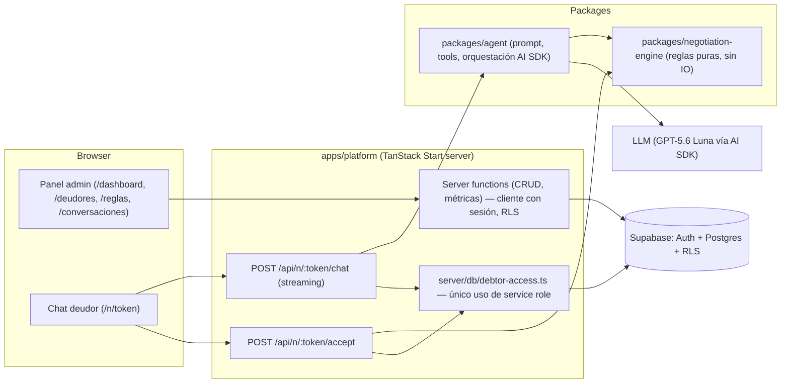
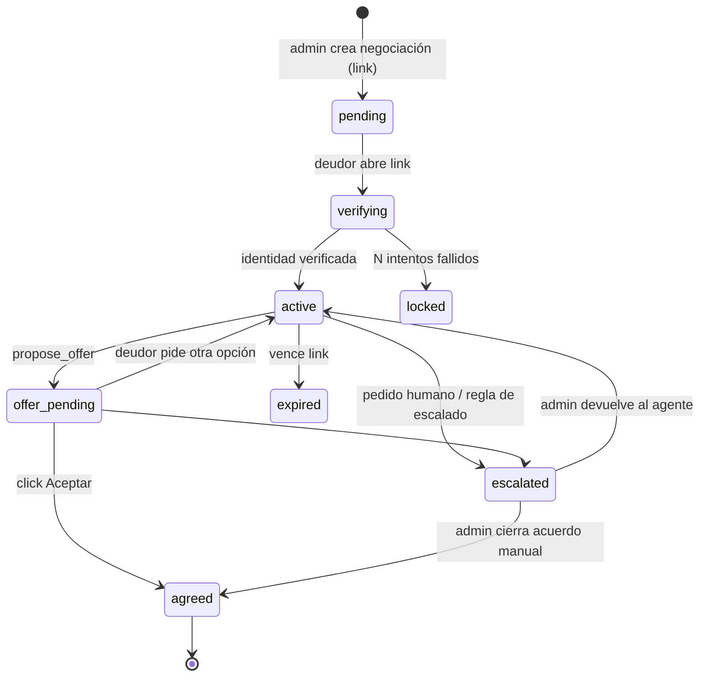
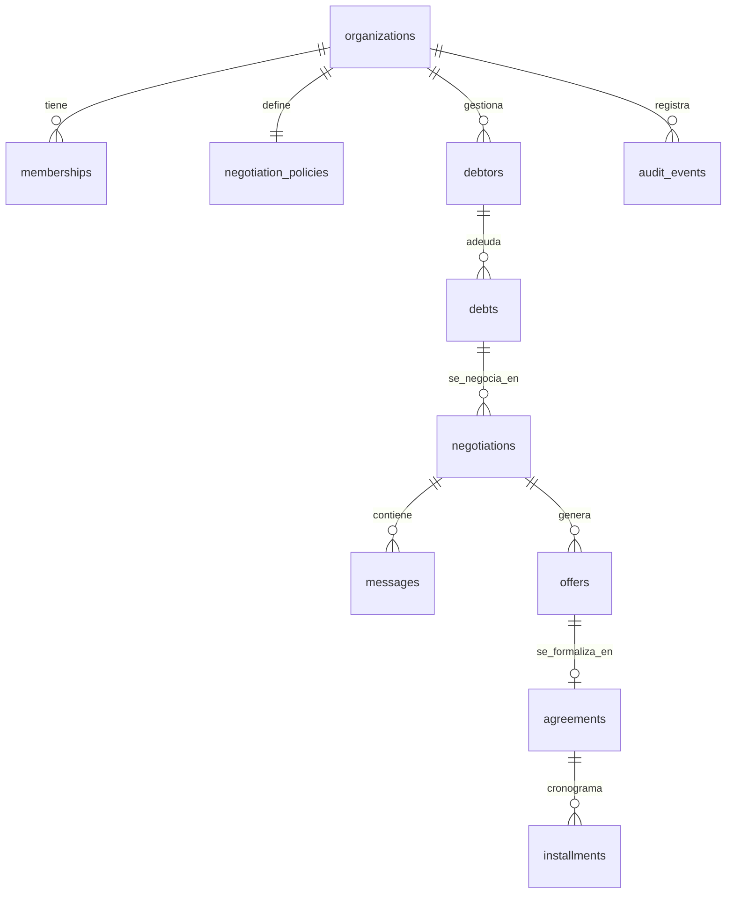
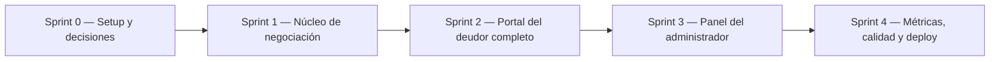

# Plan de Implementación — Backend MVP pacta.ia

> **Alcance:** todo lo necesario del lado servidor para cumplir el **Release 1 (MVP – Sandbox)** definido en [DOCUMENTACION.md](./DOCUMENTACION.md#L56-L76) y [§7.2](./DOCUMENTACION.md#L158-L161), más la conexión con el prototipo de `apps/platform`.

> **Versión 2.** Cambios respecto de la versión anterior:
>
> 1. **Fases verticales en vez de horizontales:** el núcleo de valor (agente negociando dentro de la política) se construye y valida en el Sprint 1, antes que auth y CRUD (§6).
> 2. **Recorte de alcance:** 2 paquetes en lugar de 4, polling en lugar de Realtime, política única por organización sin versionado (alcanza con el _snapshot_), un solo rol de usuario.
> 3. **Huecos de seguridad cubiertos:** sesión del deudor post‑verificación (cookie firmada), historial del chat reconstruido desde la DB (nunca desde el cliente), acceso _service role_ encapsulado en un único módulo, URLs públicas solo por token.
> 4. **Orden de recorte explícito** si no alcanza el tiempo (§8.1).

---

## 0. Diagnóstico del repositorio

| Área               | Estado actual                                                                                                                                                                                                                                                                                                                                             | Implicancia                                                                             |
| :----------------- | :-------------------------------------------------------------------------------------------------------------------------------------------------------------------------------------------------------------------------------------------------------------------------------------------------------------------------------------------------------- | :-------------------------------------------------------------------------------------- |
| Monorepo           | pnpm, `apps/*` y `packages/*` declarados en [pnpm-workspace.yaml](../pnpm-workspace.yaml). `packages/` **no existe**.                                                                                                                                                                                                                                     | Hay lugar para paquetes compartidos sin reestructurar nada.                             |
| `apps/platform`    | TanStack Start (SSR) + React 19 + shadcn. Rutas: `/`, `/login`, `/dashboard`. **No hay ninguna server function, server route ni dependencia de backend**.                                                                                                                                                                                                 | El servidor de TanStack Start ya está disponible y es el lugar natural para el backend. |
| Login              | [login.tsx](../apps/platform/src/routes/login.tsx#L15-L18) navega a `/dashboard` sin autenticar.                                                                                                                                                                                                                                                          | Hay que reemplazarlo por Auth real y proteger rutas.                                    |
| Dashboard          | Todos los datos están hardcodeados: [dashboard-overview.tsx](../apps/platform/src/components/dashboard/dashboard-overview.tsx#L24-L67), [recovery-trend-chart.tsx](../apps/platform/src/components/dashboard/recovery-trend-chart.tsx#L18-L25), [agreement-plans-chart.tsx](../apps/platform/src/components/dashboard/agreement-plans-chart.tsx#L20-L24). | Define el contrato de métricas que el backend debe exponer.                             |
| Navegación         | [app-sidebar.tsx](../apps/platform/src/components/app-sidebar.tsx#L26-L34): "Conversaciones", "Deudores", "Reglas del agente", "Configuración" deshabilitados; org ("Consorcios del Sur") y usuario ("Simon") hardcodeados. Botón "Nueva negociación" sin acción.                                                                                         | Mapa directo de las pantallas/endpoints que faltan.                                     |
| `apps/agent`       | Solo un [README](../apps/agent/README.md) ("Stack and tools are TBD").                                                                                                                                                                                                                                                                                    | Decisión pendiente (ver D1).                                                            |
| Documentación      | [DOCUMENTACION.md §5.3](./DOCUMENTACION.md#L112-L127) ubica el agente en `apps/agent`.                                                                                                                                                                                                                                                                    | Si se adopta D1‑A hay que actualizar la doc (tarea del Sprint 0).                       |
| Stack declarado    | Supabase (Auth + Postgres) y Vercel AI SDK con GPT‑5.6 Luna, ambos _pendientes_.                                                                                                                                                                                                                                                                          | Se respeta como base.                                                                   |
| Requisitos legales | [MARCO_LEGAL.md](./MARCO_LEGAL.md) exige: RLS multi-tenant, bot disclosure, LLM sin cálculo libre de montos (function calling + validación determinística), human‑in‑the‑loop, verificación de identidad, evidencia del acuerdo (timestamp, IP, aceptación explícita, hash), minimización de PII en prompts.                                              | Son requisitos **funcionales** del backend, no "nice to have".                          |
| Higiene            | Dependencias `@tanstack/*` en `"latest"` en [package.json](../apps/platform/package.json); `.env*` ya ignorado.                                                                                                                                                                                                                                           | Fijar versiones antes de empezar (evita roturas de TanStack Start entre releases).      |

---

## 1. Decisiones arquitectónicas

Cada decisión tiene una **recomendación** (⭐). Las marcadas con 🔴 bloquean el inicio del Sprint 1.

### D1 🔴 — ¿Dónde vive el backend?

| Opción                                                                                                                                                 | Pros                                                                                                        | Contras                                                     |
| :----------------------------------------------------------------------------------------------------------------------------------------------------- | :---------------------------------------------------------------------------------------------------------- | :---------------------------------------------------------- |
| ⭐ **A. Backend dentro de `apps/platform`** (server functions + server routes de TanStack Start) y la lógica de dominio en **paquetes** (`packages/*`) | Un solo deploy, sesión/cookies compartidas, tipos end‑to‑end, sin CORS. Ideal para un equipo de 5 y un MVP. | Acopla el ciclo de deploy de UI y agente.                   |
| B. Servicio separado en `apps/agent` (Hono/Fastify)                                                                                                    | Escala/deploy independiente; listo para webhooks de WhatsApp (R2).                                          | Duplica auth, CORS, dos deploys, más infra para un sandbox. |

**Recomendación:** A, con **solo dos paquetes**:

- `packages/negotiation-engine` — reglas puras, sin IO.
- `packages/agent` — prompt, tools y orquestación (reemplaza a `apps/agent`). Es una librería, así en R2 se monta detrás de un webhook de WhatsApp sin reescribir.

El acceso a datos (clientes Supabase, tipos generados, queries) y los schemas Zod viven en `apps/platform/src/server/` mientras sea el único consumidor. Se extraen a un paquete recién cuando un segundo paquete los necesite.

### D2 🔴 — Acceso a datos

| Opción                                                                                    | Detalle                                                                                                                 |
| :---------------------------------------------------------------------------------------- | :---------------------------------------------------------------------------------------------------------------------- |
| ⭐ **supabase-js + `@supabase/ssr` + migraciones SQL con Supabase CLI + tipos generados** | RLS real aplicado por la sesión del usuario (requisito legal), menos capas.                                             |
| Drizzle ORM sobre conexión Postgres directa                                               | Mejor DX de queries, pero la conexión directa **saltea RLS** salvo configuración extra; duplica el modelo de seguridad. |

### D3 🔴 — Multi‑tenancy en el MVP

La doc ubica "arquitectura multi‑tenant" en R2, pero el marco legal exige aislamiento de carteras y el dashboard ya muestra una organización. **Recomendación:** modelar `organization_id` + RLS **desde el día 1** (costo bajo ahora, migración cara después), sin UI de gestión de organizaciones: alta por seed/invitación manual. **Un solo rol** de usuario en el MVP (todo miembro puede todo); roles diferenciados quedan para R2.

### D4 🔴 — ¿Cómo accede el deudor al chat simulado?

| Opción                                                                                                                           | Detalle                                                                                                   |
| :------------------------------------------------------------------------------------------------------------------------------- | :-------------------------------------------------------------------------------------------------------- |
| ⭐ **Link único tokenizado** `/n/$token` + **verificación de identidad** (ej. últimos 3 dígitos del DNI) antes de mostrar montos | Cumple Ley 6.171 / LPDP (no exponer deuda a terceros). Es exactamente el flujo que tendrá WhatsApp en R2. |
| Solo "modo simulación" dentro del dashboard (el admin juega de deudor)                                                           | Más simple, pero no valida la experiencia del deudor ni la verificación.                                  |

**Recomendación:** ambos. El link público es el flujo real; "Probar como deudor" en el panel abre el mismo link.

**Sesión del deudor post‑verificación:** al verificar, el servidor emite una **cookie `httpOnly` firmada** (HMAC con `NEGOTIATION_TOKEN_SECRET`) que contiene `negotiation_id` + `exp` (ej. 2 h). Todos los endpoints del deudor exigen token válido **y** esa cookie; sin ella solo se ve la pantalla de verificación. Así no se reverifica en cada mensaje y un link reenviado a un tercero no expone montos.

### D5 — Modelo de reglas de negociación (qué parámetros configura el admin)

Propuesta mínima, validada contra [ENTREVISTAS.md](./ENTREVISTAS.md) y el dashboard (planes de 1–3 cuotas):

| Parámetro                            | Tipo                 | Ejemplo                               |
| :----------------------------------- | :------------------- | :------------------------------------ |
| `max_installments`                   | int                  | 3                                     |
| `min_down_payment_pct`               | %                    | 20                                    |
| `min_installment_amount`             | moneda               | $ 20.000                              |
| `max_interest_waiver_pct` (cuotas)   | %                    | 50                                    |
| `single_payment_interest_waiver_pct` | %                    | 100                                   |
| `max_principal_discount_pct`         | %                    | 0 (el capital no se toca por defecto) |
| `max_first_due_days`                 | int                  | 15                                    |
| `offer_validity_hours`               | int                  | 72                                    |
| `escalate_above_amount`              | moneda               | $ 1.000.000 → requiere humano         |
| `tone` / `custom_instructions`       | enum / texto acotado | "empático‑formal"                     |

⭐ **Una política por organización**, editable en el lugar. La trazabilidad la da el **snapshot** que cada negociación guarda al crearse (`policy_snapshot`): editar la política no afecta negociaciones en curso. Versionado de políticas y override por deuda quedan para R2.

### D6 — Representación monetaria e intereses

⭐ Montos en **centavos `bigint`** (ARS, sin flotantes). Intereses: el admin carga `principal` e `interés acumulado` al momento de crear la deuda (sin motor de devengamiento en el MVP). Cuotas **sin interés de financiación** en el MVP (simplifica y es lo que muestran las entrevistas). Revisar topes del Decreto 2417/93 para colegios en R2.

### D7 — Diseño del agente (guardrail central)

⭐ **El LLM nunca produce montos.** Toda cifra sale del motor de reglas determinístico vía _tools_; la oferta se persiste en DB y el frontend renderiza una **tarjeta de oferta** desde la DB (no desde el texto del modelo). La **aceptación es un click del deudor** sobre esa tarjeta (endpoint dedicado), nunca una tool del LLM. Ver §3.

### D8 — Proveedor/modelo y gateway

Docs fijan GPT‑5.6 Luna vía Vercel AI SDK. Decidir: provider directo (`@ai-sdk/openai`) vs **Vercel AI Gateway** (⭐ si se deploya en Vercel: fallback de modelos, observabilidad y control de costos sin código extra). En ambos casos el modelo se inyecta por config para poder testear con `MockLanguageModel`.

### D9 — Handoff humano

Cuando el deudor pide "hablar con una persona" o el motor escala, la negociación pasa a `escalated` y el admin puede escribir desde el panel.

- ⭐ **Polling** cada ~5 s del lado del deudor (y del panel) mientras la negociación está en `escalated`. Cero infraestructura extra y suficiente para un sandbox.
- Supabase Realtime queda como mejora opcional (requiere autorizar canales para un usuario sin cuenta, que es justamente el deudor).

### D10 — Métrica "Monto recuperado"

El dashboard muestra "Monto recuperado", pero **el MVP no procesa pagos** (links de pago son R2). Opciones:

- ⭐ Mostrar **"Monto acordado"** (comprometido en actas) + permitir al admin **marcar cuotas como pagadas** manualmente → "Monto recuperado" real y base para la comisión por éxito.
- Renombrar la tarjeta a "Monto acordado" y posponer el seguimiento de cuotas.

### D11 — Documento del acuerdo

⭐ Acta en **HTML imprimible / "Guardar como PDF"** generada desde una plantilla versionada, con: partes, plan, cronograma, `accepted_at`, IP, user‑agent, **SHA‑256 del transcript** y snapshot de política. PDF server‑side (`@react-pdf/renderer`) y envío por mail quedan para R2.

### D12 — Deploy y entornos

⭐ **Vercel** (soporte nativo de TanStack Start y streaming del AI SDK) + **Supabase Cloud** (proyecto `dev` y `prod`; local con `supabase start`). Variables: `SUPABASE_URL`, `SUPABASE_ANON_KEY`, `SUPABASE_SERVICE_ROLE_KEY` (solo servidor), `AI_GATEWAY_API_KEY`/`OPENAI_API_KEY`, `NEGOTIATION_TOKEN_SECRET`.

---

## 2. Arquitectura propuesta



`packages/agent` **no accede a la base**: recibe por parámetro los datos de la negociación y funciones de persistencia (`saveOffer`, `escalate`, `logEvent`) que le inyecta el endpoint. Así se testea sin Supabase y la regla "solo `debtor-access.ts` usa service role" se cumple por construcción.

### Estructura de carpetas objetivo

```text
apps/
  platform/
    src/
      routes/
        _authed.tsx                 # layout protegido (beforeLoad → sesión)
        _authed/dashboard.tsx
        _authed/deudores/index.tsx, $debtorId.tsx
        _authed/conversaciones/index.tsx, $negotiationId.tsx
        _authed/reglas.tsx
        _authed/acuerdos/$agreementId.tsx
        n/$token.tsx                # chat público del deudor
        api/n/$token/chat.ts
        api/n/$token/accept.ts
      server/
        db/
          supabase-server.ts        # cliente con sesión del admin (RLS)
          debtor-access.ts          # ÚNICO módulo con service role, siempre acotado a una negociación
          types.gen.ts              # supabase gen types
        schemas/                    # Zod (inputs de server fns y DTOs)
        debtor-session.ts           # firma/verificación de la cookie del deudor
        auth.ts  debtors.ts  policies.ts  negotiations.ts  metrics.ts
packages/
  negotiation-engine/ # money utils, getNegotiationBounds, evaluateRequest, buildSchedule, requiresHuman + tests
  agent/              # systemPrompt, tools, runNegotiationTurn() + evals
supabase/
  migrations/  seed.sql  config.toml
```

---

## 3. Diseño del agente y motor de reglas

### 3.1 Motor de reglas (`packages/negotiation-engine`) — puro y 100 % testeado

- `getNegotiationBounds(debt, policy)` → rangos permitidos (cuotas min/max, anticipo mínimo, quita máxima según modalidad).
- `evaluateRequest(debt, policy, request)` → `{ ok: true, offer } | { ok: false, reason, closestValidOffer }`. Nunca lanza; siempre devuelve una alternativa válida si existe.
- `buildSchedule(offer, startDate)` → cronograma de cuotas con redondeo determinístico (el resto va a la última cuota).
- `requiresHuman(debt, policy, context)` → reglas de escalado.

### 3.2 Tools expuestas al LLM (`packages/agent`)

| Tool                                            | Efecto                                                                                    | Notas                                                                                                                                            |
| :---------------------------------------------- | :---------------------------------------------------------------------------------------- | :----------------------------------------------------------------------------------------------------------------------------------------------- |
| `get_debt_summary`                              | Lee deuda (capital, interés, vencimiento, concepto)                                       | Solo disponible con la sesión del deudor verificada. Usa alias ("Unidad 4B"), no DNI/nombre completo (minimización PII).                         |
| `get_negotiation_options`                       | Devuelve los límites de la política en lenguaje entendible                                | Para que el agente explique opciones sin inventar.                                                                                               |
| `simulate_plan({ installments, downPayment? })` | Llama a `evaluateRequest`                                                                 | Si está fuera de política, devuelve la alternativa más cercana y **registra un evento `out_of_policy_request`** (alimenta "Requieren atención"). |
| `propose_offer({ installments, downPayment? })` | Revalida con el motor y persiste una `offer` en estado `proposed` (supersede la anterior) | Devuelve `offerId`; el front muestra la tarjeta con botón **Aceptar**.                                                                           |
| `escalate_to_human({ reason })`                 | Pasa la negociación a `escalated`, el agente deja de responder                            | También se dispara por palabra clave del deudor ("hablar con una persona") sin pasar por el LLM.                                                 |

### 3.3 Guardrails

1. **System prompt** con: prohibición de amenazas judiciales/embargos, tono empático, no revelar datos a terceros, no prometer nada fuera de tools. El **primer mensaje es determinístico** (bot disclosure + nombre de la administración + link al aviso de privacidad), no generado por el LLM.
2. **Historial solo desde la DB.** `useChat` envía la conversación completa desde el navegador: el endpoint toma **únicamente el último mensaje del deudor** (texto, con tamaño máximo) y reconstruye el resto desde `messages`. Evita que el deudor inyecte mensajes falsos del agente o resultados de tools.
3. **Validación post‑generación:** si el texto del modelo contiene montos/porcentajes que no coinciden con la última respuesta de tool → se reemplaza por un mensaje seguro y se loguea (`guardrail_violation`). Implementación simple: extraer cifras por regex y compararlas contra los valores devueltos por las tools en ese turno.
4. **Límite de pasos** de tools por turno (`stopWhen: stepCountIs(5)`) y límite de turnos por negociación.
5. **Rate limiting** simple por token en el endpoint de chat (ej. contador en DB por minuto).
6. **Aceptación fuera del LLM:** `POST /accept` revalida la oferta contra el _snapshot_ de política, verifica vigencia, y crea el acuerdo en una transacción (RPC Postgres).
7. **Service role encapsulado:** solo `server/db/debtor-access.ts` crea ese cliente; todas sus funciones reciben el `negotiation_id` **obtenido de la cookie verificada**, nunca de un parámetro enviado por el cliente.

### 3.4 Máquina de estados de la negociación



---

## 4. Modelo de datos (Supabase / Postgres)



| Tabla                  | Campos clave                                                                                                                                                |
| :--------------------- | :---------------------------------------------------------------------------------------------------------------------------------------------------------- |
| `organizations`        | `id`, `name`, `kind` (`consorcio`/`colegio`), `display_name_for_debtors`                                                                                    |
| `memberships`          | `user_id` → `auth.users`, `organization_id` (sin roles en el MVP)                                                                                           |
| `negotiation_policies` | `organization_id` (único), parámetros de D5, `updated_at`                                                                                                   |
| `debtors`              | `organization_id`, `full_name`, `alias` (ej. "Unidad 4B"), `group_label` (edificio/curso), `email`, `phone`, `verification_hash`                            |
| `debts`                | `debtor_id`, `concept`, `principal_cents`, `interest_cents`, `due_date`, `status` (`open`/`in_negotiation`/`agreed`/`paid`/`written_off`)                   |
| `negotiations`         | `debt_id`, `status` (§3.4), `policy_snapshot jsonb`, `token_hash`, `verified_at`, `verification_attempts`, `expires_at`, `channel` (`web_sim`)              |
| `messages`             | `negotiation_id`, `role` (`debtor`/`agent`/`admin`/`system`), `parts jsonb` (formato `UIMessage` del AI SDK), `created_at`                                  |
| `offers`               | `negotiation_id`, `installments`, `down_payment_cents`, `waived_interest_cents`, `total_cents`, `schedule jsonb`, `status`, `valid_until`, `engine_version` |
| `agreements`           | `offer_id`, `accepted_at`, `acceptance_ip`, `user_agent`, `transcript_sha256`, `document_html`, `template_version`                                          |
| `installments`         | `agreement_id`, `number`, `due_date`, `amount_cents`, `paid_at?` (D10)                                                                                      |
| `audit_events`         | `organization_id`, `negotiation_id?`, `type` (`out_of_policy_request`, `escalated`, `guardrail_violation`, `offer_proposed`, ...), `payload jsonb`          |

**RLS:** todas las tablas filtran por `organization_id IN (select organization_id from memberships where user_id = auth.uid())` (función helper `is_member(org_id)`). El deudor **no tiene usuario**: sus accesos pasan por `debtor-access.ts` (§3.3‑7). Token de negociación: 32 bytes aleatorios, se guarda **solo el hash**.

**Vistas/RPC para el dashboard:** `v_dashboard_kpis`, `v_monthly_recovery`, `v_agreements_by_plan`, `v_recent_agreements`, `v_attention_items` (todas con `security_invoker = true` para respetar RLS). RPC transaccional `accept_offer(offer_id, ip, ua)`.

---

## 5. Contrato backend ↔ frontend

| Pantalla (existente / nueva) | Hoy             | Backend que la alimenta                                                                                                                                                                                                                            |
| :--------------------------- | :-------------- | :------------------------------------------------------------------------------------------------------------------------------------------------------------------------------------------------------------------------------------------------- |
| `/login`                     | navega sin auth | `signInWithPassword` (Supabase) vía server fn; cookies con `@supabase/ssr`. "Solicitar acceso" → mailto. "Olvidé contraseña" → reset de Supabase.                                                                                                  |
| Layout protegido             | —               | `_authed.tsx` con `beforeLoad` → `getSessionFn()`; devuelve usuario + organización al contexto del router (reemplaza "Simon" / "Consorcios del Sur" en [app-sidebar.tsx](../apps/platform/src/components/app-sidebar.tsx#L48-L56)).                |
| `/dashboard` tarjetas        | mock            | `getDashboardKpis()` → `{ recoveredCents, agreedCents, deltaVsPrevMonthPct, agreementsCount, agreementsThisWeek, activeConversations, awaitingReply }`                                                                                             |
| Gráfico evolución            | mock            | `getMonthlyRecovery({ months: 6 })` → `[{ month, amountCents }]`                                                                                                                                                                                   |
| Gráfico por plan             | mock            | `getAgreementsByPlan({ period })` → `[{ installments, count }]` (el front mapea a "Pago único/2/3 cuotas")                                                                                                                                         |
| Acuerdos recientes           | mock            | `listRecentAgreements({ limit: 3 })`                                                                                                                                                                                                               |
| Requieren atención           | mock            | `getAttentionItems()` → escaladas, ofertas sin respuesta > X h, pedidos fuera de política                                                                                                                                                          |
| Botón "Nueva negociación"    | sin acción      | Sheet: elegir/crear deudor + deuda → `createNegotiation()` → devuelve link `/n/$token` copiable + "Probar como deudor"                                                                                                                             |
| Deudores (sidebar)           | disabled        | `listDebtors`, `createDebtor`, `createDebt`, `updateDebt`                                                                                                                                                                                          |
| Conversaciones (sidebar)     | disabled        | `listNegotiations({ status })`, `getNegotiation(id)` (transcript + ofertas + eventos), `sendAdminMessage`, `returnToAgent`, `closeManually`                                                                                                        |
| Reglas del agente (sidebar)  | disabled        | `getPolicy`, `updatePolicy` + **previsualización**: `previewPlans(policy, sampleDebt)` usando el motor                                                                                                                                             |
| Configuración                | disabled        | `getOrganization`, `updateOrganization` (nombre visible al deudor, tipo)                                                                                                                                                                           |
| `/n/$token` (nuevo)          | —               | `getPublicNegotiation(token)` (sin montos hasta verificar), `verifyIdentity(token, answer)` → setea cookie, `getMessagesSince(token, cursor)` (polling en `escalated`), `POST /api/n/$token/chat` (stream, `useChat`), `POST /api/n/$token/accept` |
| `/acuerdos/$id` (nuevo)      | —               | `getAgreement(id)` → acta imprimible; `markInstallmentPaid`                                                                                                                                                                                        |

Convenciones: validación de input con **Zod** en todas las server fns, errores tipados `{ code, message }`, datos de servidor consumidos con **TanStack Query** (ya está `@tanstack/react-router-ssr-query` en dependencias) + `loader` para SSR. Las URLs públicas usan **solo el token**; nunca se exponen ids internos al deudor.

---

## 6. Plan de implementación por sprints (vertical)

Se construye primero el **núcleo de valor** (negociación dentro de la política) y después las pantallas de administración. Si el tiempo no alcanza, lo que queda afuera son pantallas, no el corazón del producto.



### Sprint 0 — Setup y cierre de decisiones (corto)

- [x] Cerrar D1–D4 (bloqueantes) y registrarlas en [DOCUMENTACION.md §5.4](./DOCUMENTACION.md#54-decisiones-de-arquitectura-del-backend) (actualizar §5.3: `apps/agent` → `packages/agent`).
- [x] Fijar versiones de las dependencias `latest` en [package.json](../apps/platform/package.json#L19-L24).
- [x] Crear `packages/negotiation-engine` y `packages/agent` con `package.json`, `tsconfig` base compartido ([tsconfig.base.json](../tsconfig.base.json)) y Vitest.
- [x] Supabase CLI: `supabase init` y [.env.example](../apps/platform/.env.example) documentado.
- [ ] Supabase: crear proyecto `dev` en la nube y `pnpm supabase link --project-ref <ref>`.
- [x] Scripts raíz (`typecheck`, `test`, `db:*`, `smoke:llm`) y CI en [.github/workflows/ci.yml](../.github/workflows/ci.yml) (typecheck + test + build).
- [ ] Acceso al LLM: key de AI Gateway + `AI_MODEL` en `.env.local`; `pnpm smoke:llm` responde.
- [x] Formatear el código existente (`pnpm format`), corregir los errores de `pnpm lint`, agregar `.gitattributes` con `eol=lf` y sumar ambos chequeos al CI.
- [x] Cargar los sprints como tickets en Linear; una rama + PR chico por ticket.

**Criterio:** `pnpm install && pnpm -r typecheck` pasa; `supabase start` levanta local.

### Sprint 1 — Núcleo de negociación (sin auth ni CRUD)

Objetivo: **un deudor de seed negocia por chat y recibe ofertas siempre dentro de la política.**

- [x] Migraciones de **todas** las tablas de §4 con enums, índices y RLS habilitado ([init_schema](../supabase/migrations/20261022000929_init_schema.sql)). Además: FKs compuestas `(id, organization_id)` para que no se puedan relacionar filas de organizaciones distintas, y privilegios explícitos por tabla para `authenticated` (ofertas y acuerdos solo los escribe el servidor).
- [x] `seed.sql`: org "Consorcios del Sur", usuario demo `demo@pacta.ai` / `demo1234`, política, 12 deudores / 13 deudas, 6 acuerdos históricos y **negociación con token conocido** (`/n/dev-4b`). DNI de verificación de todos los deudores: terminación `123`.
- [x] Tipos generados → `apps/platform/src/server/db/types.gen.ts` (`pnpm db:types`).
- [x] Motor de reglas: utilidades monetarias en centavos, `getNegotiationBounds`, `evaluateRequest`, `buildSchedule`, `requiresHuman`, con tests exhaustivos (cuota mínima, anticipo, redondeo, quita 100 % en pago único, umbral de escalado). Objetivo ≥ 95 % de cobertura del paquete.
- [x] `packages/agent`: system prompt versionado, tools de §3.2 con `inputSchema` Zod, `runNegotiationTurn({ negotiation, lastMessage, history, model, persistence })` sobre `streamText`.
- [ ] `server/db/debtor-access.ts` y endpoint `POST /api/n/$token/chat`: valida token y estado, reconstruye el historial desde la DB, ejecuta el turno, persiste mensajes (`onFinish`), devuelve `toUIMessageStreamResponse()`.
- [ ] Página `/n/$token` mínima con `useChat` (sin verificación todavía).

> **Paralelización:** motor de reglas (1 persona), agente + endpoint (2 personas), migraciones + seed (1 persona). La quinta persona puede adelantar la UI del chat del deudor.

**Criterio:** con el token de seed se puede negociar; pedir 12 cuotas o quita total nunca genera una oferta fuera de política.

### Sprint 2 — Portal del deudor completo

- [ ] Pantalla de bienvenida (sin montos) → verificación de identidad → cookie firmada (D4); bloqueo tras N intentos.
- [ ] Mensaje inicial determinístico (bot disclosure + aviso de privacidad).
- [ ] **OfferCard** renderizada desde el `tool-propose_offer` part / DB, con botón "Acepto los términos del plan de pago".
- [ ] `POST /api/n/$token/accept`: captura IP/UA, RPC `accept_offer`, `transcript_sha256`, genera acta HTML, devuelve link al acta.
- [ ] Botón permanente "Hablar con una persona" + interceptor de palabra clave antes del LLM.
- [ ] Validador post‑generación de cifras (§3.3‑3) y límites de pasos/turnos.
- [ ] Estados terminales (acordado, escalado, vencido, bloqueado) con UI clara; polling de mensajes en `escalated`.

**Criterio:** flujo completo deudor: link → verificación → negociación → aceptación → acta con evidencia.

### Sprint 3 — Panel del administrador

- [x] Factories `createServerSupabase()` (cookies vía `@tanstack/react-start/server`); server fns `signIn`, `signOut`, `getSessionContext`; conectar [login.tsx](../apps/platform/src/routes/login.tsx). Los server fns del panel usan `authMiddleware` ([middleware.ts](../apps/platform/src/server/middleware.ts)).
- [x] Layout `_authed` con `beforeLoad` + redirect a `/login`; mover `/dashboard` debajo; sidebar con usuario/organización reales y logout.
- [x] **Test de RLS** con pgTAP ([rls.test.sql](../supabase/tests/database/rls.test.sql), `pnpm db:test`): 16 asserts sobre aislamiento entre organizaciones, FKs compuestas, privilegios del panel y acceso anónimo.
- [x] Deudores y deudas (lista con búsqueda y estado, alta con primera deuda, edición, marcar pagada / incobrable / reabrir). El DNI se guarda solo como hash de los últimos 3 dígitos.
- [x] Reglas del agente: formulario de D5 con Zod.
- [ ] Reglas del agente: previsualización de planes con el motor (depende del motor de reglas, Sprint 1).
- [x] "Nueva negociación" (dashboard y ficha del deudor): crea negociación, guarda snapshot de política y hash del token, muestra el link una única vez.
- [ ] Botón "Probar como deudor" (depende de `/n/$token`, Sprints 1–2).
- [x] Conversaciones: lista filtrable por estado, detalle con transcript/ofertas/reglas aplicadas/actividad, tomar control / devolver al agente / cancelar link, mensajes de la administración y polling cada 10 s (D9).
- [ ] Cerrar acuerdo manual desde el panel (depende del motor de reglas para validar la oferta).
- [x] Vista `/acuerdos/$id` imprimible + marcar cuotas pagadas (D10); la deuda pasa a "pagada" al cobrar todas las cuotas.
- [x] Configuración de la organización (nombre visible para el deudor y tipo).
- [x] Habilitar items del sidebar.
- [ ] "¿Olvidaste tu contraseña?" y "Solicitar acceso" en el login (siguen sin acción).

### Sprint 4 — Métricas, calidad y deploy

- [ ] Reemplazar los arrays mock del dashboard por `loader` + `useSuspenseQuery` contra las server fns de §5; estados vacíos y skeletons ([skeleton.tsx](../apps/platform/src/components/ui/skeleton.tsx)).
- [ ] [dashboard-preview.tsx](../apps/platform/src/components/dashboard-preview.tsx) de la landing sigue con datos mock: separar componentes presentacionales (reciben props) para reutilizarlos en ambos lados.
- [ ] **Evals del agente**: ~20 escenarios (cooperativo, pide 12 cuotas, pide quita total, agresivo, prompt injection "ignorá tus reglas", tercero que no es el titular, pide humano). Assert: nunca se crea una oferta fuera de política, siempre hay disclosure, se escala cuando corresponde. Con `MockLanguageModel` en CI y con el modelo real on‑demand.
- [ ] Tests de integración de `/chat` y `/accept` con Supabase local.
- [ ] Rate limit y tamaño máximo de mensaje en `/chat`.
- [ ] Logging estructurado + registro de tokens consumidos por negociación (insumo para el modelo de costos de [§6](./DOCUMENTACION.md#L129-L140)).
- [ ] Deploy Vercel + Supabase prod; secrets por entorno.
- [ ] Guion de demo y seed reproducible.
- [ ] Actualizar [USO_IA.md](./USO_IA.md) con el uso de IA durante el desarrollo del backend.

---

## 7. Definición de "MVP backend cumplido"

1. Un admin inicia sesión y solo ve datos de su organización (RLS verificado por test).
2. Puede cargar un deudor + deuda y configurar reglas de negociación.
3. Puede generar un link de negociación y probarlo como deudor.
4. El deudor se verifica, conversa en lenguaje natural y recibe ofertas **siempre dentro de la política** (garantizado por motor + tests + evals).
5. El deudor acepta con un click y se genera un acta con evidencia (timestamp, IP, hash, snapshot de política).
6. El deudor puede pedir un humano y el admin puede tomar la conversación.
7. El dashboard muestra métricas reales derivadas de la base.

---

## 8. Riesgos y mitigaciones

| Riesgo                                                       | Mitigación                                                                                                                                                       |
| :----------------------------------------------------------- | :--------------------------------------------------------------------------------------------------------------------------------------------------------------- |
| Inestabilidad de APIs de TanStack Start (versiones `latest`) | Fijar versiones en Sprint 0; aislar el dominio en `packages/*` para no depender del framework.                                                                   |
| El LLM inventa montos o promete condiciones                  | D7 + validador post‑generación + evals en CI.                                                                                                                    |
| Prompt injection del deudor                                  | Las tools validan contra el _snapshot_ del servidor; el modelo no tiene tools de escritura arbitraria; aceptación fuera del LLM.                                 |
| Manipulación del historial desde el navegador                | El servidor solo acepta el último mensaje del deudor y reconstruye el resto desde la DB (§3.3‑2).                                                                |
| Fuga de la service role key o uso fuera de alcance           | Un único módulo (`debtor-access.ts`) la usa, siempre acotado al `negotiation_id` de la cookie verificada; revisión en PR de cualquier import fuera de `server/`. |
| Link de negociación reenviado a un tercero                   | Montos visibles solo tras verificación de identidad; cookie de corta duración; bloqueo tras N intentos.                                                          |
| Costos de inferencia                                         | Límite de turnos, modelo configurable, registro de tokens por negociación.                                                                                       |
| Alcance excesivo                                             | WhatsApp, links de pago, CSV, PDF server‑side, mails, Realtime, roles y versionado de políticas quedan explícitamente en R2.                                     |

### 8.1 Orden de recorte si no alcanza el tiempo

Recortar de arriba hacia abajo; nada por debajo de la línea se recorta porque es el núcleo del MVP o un requisito legal.

1. Marcar cuotas como pagadas (D10 → mostrar solo "Monto acordado").
2. Previsualización de planes en Reglas del agente.
3. Cierre de acuerdo manual por el admin (queda: tomar control y devolver al agente).
4. Pantalla de Configuración (se edita por seed).
5. Validador post‑generación de cifras (queda cubierto por motor + tarjeta de oferta desde DB).

**No recortable:**

Motor de reglas con tests · agente con tools · verificación de identidad · tarjeta de oferta y aceptación con evidencia · bot disclosure · "Hablar con una persona" · RLS · login.
